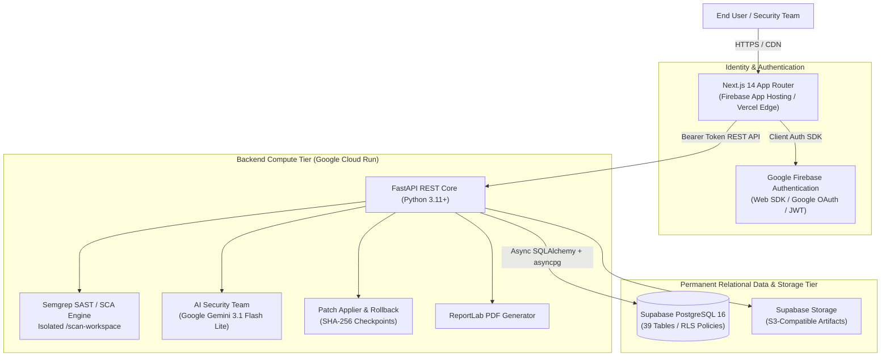

# SHADOWOPS — Enterprise Monorepo

> **"Your AI Security Team. Always Watching."**

ShadowOps is an AI-native cybersecurity SaaS platform designed specifically for fast-moving startups and enterprise engineering teams. It transforms reactive vulnerability management into an autonomous, proactive security lifecycle: discovering attack surfaces, conducting deep static and dependency scans, correlating vulnerabilities into exploitable attack paths, dispatching multi-agent AI security experts, generating verified code-level remediations with human-in-the-loop safeguards, and empirically verifying that fixes eliminated the risk without breaking production.

---

## 1. Verified Production Architecture

The production architecture maintains clean separation of concerns with Supabase as the permanent database source of truth:



| Layer | Technology | Hosting Platform | Status |
| :--- | :--- | :--- | :--- |
| **Frontend** | Next.js 14 (App Router), React 18, TypeScript, Tailwind CSS | **Firebase App Hosting** (or Vercel Edge) | Certified & Configured ([`frontend/apphosting.yaml`](file:///d:/Shreyanshcodes/shadow-ops-v2/frontend/apphosting.yaml)) |
| **Backend API** | Python 3.11+, FastAPI, SQLAlchemy 2.0 (async), `asyncpg` | **Google Cloud Run** | Certified & Containerized ([`backend/Dockerfile`](file:///d:/Shreyanshcodes/shadow-ops-v2/backend/Dockerfile)) |
| **Database** | Supabase PostgreSQL 16 (All 39 Tables, RLS, Functions) | **Supabase Cloud** | **Permanent Active Source of Truth** |
| **Object Storage** | S3-compatible private buckets with signed URLs | **Supabase Storage** | Permanent Active Storage |
| **Authentication** | Firebase Auth Web SDK + `firebase-admin` token verifier | **Google Firebase** | Live & Active (`shadow-ops-6957d`) |
| **AI Advisory** | Google Gemini 3.1 Flash Lite orchestrator | **Google AI** | Live & Active |
| **Code Scanning** | Semgrep CLI with SARIF ingestion | **Cloud Run Container** | Active & Sandboxed |

> [!NOTE]  
> **Database Architecture Decision:** The previously considered migration to Google Cloud SQL and Firebase Data Connect has been **CANCELLED**. Supabase PostgreSQL 16 remains the permanent database and storage platform. See [`docs/DEPLOYMENT_ARCHITECTURE_CORRECTION.md`](file:///d:/Shreyanshcodes/shadow-ops-v2/docs/DEPLOYMENT_ARCHITECTURE_CORRECTION.md) for full architectural rationale.

---

## 2. Core Platform Capabilities

### 2.1 Asset Inventory & Authorization Guardrails
- **Multi-Type Attack Surface Management:** Catalogs repositories, domains, IP ranges, and cloud assets.
- **Mandatory Authorization Gate:** Enforces the absolute invariant: **`NO AUTHORIZATION → NO SCAN`**. Scanning cannot execute without cryptographically verified asset ownership proof.
- **Environment & Criticality Tagging:** Dynamically tags assets across production, staging, and development with tier-based risk weighting.

### 2.2 Multi-Engine Security Scanning
- **Containerized Semgrep SAST/SCA:** Integrates Semgrep for deep semantic static analysis, software composition analysis (SCA), and secret leakage detection.
- **SARIF Standard Ingestion:** Normalizes findings into standard SARIF schema with automated fingerprint deduplication.
- **Scan Telemetry & Event Streaming:** Real-time log capture (`queued` → `running` → `completed`) with event-level tracking.

### 2.3 Attack Path Graph Synthesis
- **Relational Asset Graph:** Synthesizes directed acyclic graphs (DAG) representing multi-step lateral movement and privilege escalation chains.
- **Deterministic Exploitability Scoring:** Computes composite risk scores using mathematical graph weightings rather than unverified LLM guesses.
- **Blast Radius Analysis:** Identifies critical choke points where fixing a single vulnerability breaks multiple attack paths.

### 2.4 Autonomous AI Security Team
- **Specialized AI Security Personas:** AppSec Specialist, Cloud Infrastructure Architect, and Red Team Adversary.
- **Google Gemini 3.1 Flash Lite Orchestration:** Sub-second latency AI consultations with bounded token budgets and strict cost-capping ($2.00 max per run).
- **Immutable Fact Boundary:** AI agents cannot override verified scanner findings or alter severity ratings.

### 2.5 Human-in-the-Loop Automated Remediation
- **Syntax-Aware AST Patching:** Generates unified diffs and code patches tailored to specific file lines.
- **Dual Human Approvals:** Requires authorized workspace administrators to review and sign off before patch application.
- **Cryptographic Rollback Checkpoints:** Captures SHA-256 filesystem snapshots and git commit hashes prior to applying any patch, guaranteeing instant one-click rollback if regressions occur.

### 2.6 Independent Empirical Verification
- **Automated Post-Patch Re-scanning:** Re-executes targeted scanners on patched code to verify vulnerability extinction.
- **Delta Comparison Engine:** Compares baseline vs. post-patch findings to detect new or reintroduced issues.
- **Regression Auditing:** Executes test suites and validates deterministic verification policy verdicts (`VERIFIED_CANDIDATE`, `FAILED`, `INCONCLUSIVE`, `BLOCKED`).

### 2.7 Compliance & Executive Reporting
- **Multi-Format Export Engine:** Produces executive summaries, technical delta reports, and audit packages in PDF, JSON, CSV, and HTML formats.
- **SOC2 & ISO 27001 Mapping:** Correlates findings and remediations against compliance control frameworks.
- **Cryptographic Report Signing:** Signs report payloads with SHA-256 hashes for non-repudiation.

### 2.8 Transactional Outbox & Real-Time Notifications
- **Transactional Outbox Pattern:** Decouples event generation from delivery, guaranteeing zero event loss.
- **Multi-Channel Alerting:** Dispatches notifications via in-app feeds, email adapters, and external webhooks (n8n automations).
- **User Preference Matrix:** Granular filtering to mute low-severity alerts while ensuring critical alerts always pierce through.

### 2.9 Interactive AI Security Chat (Sentinel)
- **Telemetry-Grounded Advisories:** Consults directly with workspace telemetry (findings, attack paths, assets) rather than generic web models.
- **Custom Markdown AST Engine:** Formats bold, italics, underlines, syntax-highlighted code blocks, tables, and lists cleanly without raw syntax leaks.

### 2.10 Enterprise Onboarding & Join Flow
- **Dual-Track Registration:** Company workspace registration vs. employee join directory.

---

## 3. Monorepo Directory Structure

```
shadowops/
├── frontend/                     # Next.js 14 App Router application
│   ├── app/                      # Route segments (dashboard, scans, findings, chat, onboarding)
│   ├── components/               # Cyberpunk dark UI design system (cards, badges, modals, charts)
│   ├── lib/                      # Firebase client, API clients, markdown parsers, utils
│   ├── hooks/                    # Custom React hooks (useAuth, useWorkspace, useScan)
│   ├── types/                    # Shared TypeScript interfaces and DTOs
│   ├── .env.example              # Client-safe environment variable reference
│   ├── apphosting.yaml           # Firebase App Hosting deployment configuration
│   └── vercel.json               # Vercel deployment configuration
├── backend/                      # Python FastAPI REST API server
│   ├── app/
│   │   ├── api/v1/               # API route controllers (workspaces, scans, findings, ai, etc.)
│   │   ├── core/                 # Configuration (pydantic-settings), structured logging
│   │   ├── db/                   # Async SQLAlchemy session (Supabase PostgreSQL asyncpg)
│   │   ├── models/               # 39 SQLAlchemy ORM relational models
│   │   ├── schemas/              # Pydantic v2 request and response schemas
│   │   ├── repositories/         # Parameterized, workspace-scoped data access layer
│   │   ├── services/             # Business logic (scans, AI team, patches, reports, outbox)
│   │   ├── security/             # Firebase JWT verification, RBAC role guardrails
│   │   ├── ai/                   # Gemini & Grok multi-agent orchestrator
│   │   ├── scanners/             # Semgrep execution abstraction and timeout supervisor
│   │   └── workers/              # Background job processing and event outbox workers
│   ├── tests/                    # 106 automated tests (Pytest, pytest-asyncio, tenant isolation)
│   ├── Dockerfile                # Dedicated Cloud Run container configuration
│   └── requirements.txt          # Python runtime dependencies
├── supabase/
│   └── migrations/               # Canonical PostgreSQL migrations (0001 through 0012)
├── docs/                         # Production documentation & migration runbooks
│   ├── DEPLOYMENT_ARCHITECTURE_CORRECTION.md # Official architecture correction & verification report
│   ├── VERCEL_DEPLOYMENT.md      # Alternative Vercel frontend deployment guide
│   └── [ARCHIVED] Cloud SQL / Data Connect migration specifications
└── firebase.json                 # Firebase Hosting configuration
```

---

## 4. Complete Database Model Inventory (39 Tables)

The ShadowOps transactional schema on Supabase PostgreSQL consists of **39 normalized relational tables**:

| Subsystem | Tables |
| :--- | :--- |
| **Identity & Workspaces** | `profiles`, `workspaces`, `workspace_members`, `roles` |
| **Assets & Authorizations** | `assets`, `asset_authorizations` |
| **Scanning & Execution** | `scans`, `scan_events`, `agent_runs` |
| **Findings & Analysis** | `findings`, `finding_evidence`, `risk_assessments`, `finding_ai_analysis` |
| **Attack Paths & Graph** | `security_relationships`, `risk_snapshots`, `attack_paths`, `attack_path_nodes`, `attack_path_edges`, `security_team_runs` |
| **Remediation Lifecycle** | `remediation_proposals`, `remediation_approvals`, `remediation_validations`, `remediation_checkpoints`, `remediation_applications` |
| **Empirical Verification** | `verification_runs`, `verification_jobs`, `verification_comparisons`, `verification_regression_checks`, `verification_reviews` |
| **Governance & Chat** | `reports`, `chat_conversations`, `chat_messages`, `audit_logs` |
| **Event Outbox & Routing** | `notifications`, `event_outbox`, `notification_preferences`, `notification_rules`, `notification_deliveries`, `workflow_runs` |

---

## 5. Quick Start & Local Development

### 5.1 Backend Setup
```bash
cd backend
python -m venv venv
source venv/bin/activate  # On Windows: venv\Scripts\activate
pip install -r requirements.txt
cp .env.example .env

# Run automated tests (106 tests)
pytest tests

# Start development server
uvicorn app.main:app --host 127.0.0.1 --port 8000 --reload
```

### 5.2 Frontend Setup
```bash
cd frontend
npm install
npm run typecheck
npm run build
npm run dev
# Accessible at http://localhost:3000
```

### 5.3 Deployment Runbooks
- **Vercel Frontend Deployment:** Refer to the comprehensive step-by-step guide in [`docs/VERCEL_DEPLOYMENT_GUIDE.md`](file:///d:/Shreyanshcodes/shadow-ops-v2/docs/VERCEL_DEPLOYMENT_GUIDE.md).
- **Backend Deployment:** Refer to [`backend/Dockerfile`](file:///d:/Shreyanshcodes/shadow-ops-v2/backend/Dockerfile) and [`docs/DEPLOYMENT_ARCHITECTURE_CORRECTION.md`](file:///d:/Shreyanshcodes/shadow-ops-v2/docs/DEPLOYMENT_ARCHITECTURE_CORRECTION.md).

---

## 6. Automated Testing Verification

The platform is fortified by a comprehensive automated test suite in [`backend/tests`](file:///d:/Shreyanshcodes/shadow-ops-v2/backend/tests):
- **106 / 106 automated backend tests passing** with 0 failures (`pytest backend/tests`).
- **Frontend TypeScript typecheck passing** with 0 errors (`npm run typecheck`).
- **All 24 Next.js routes compiled successfully** in production build (`npm run build`).
