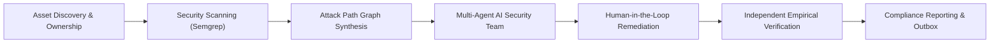
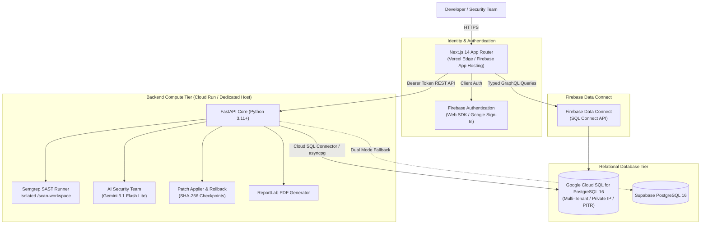
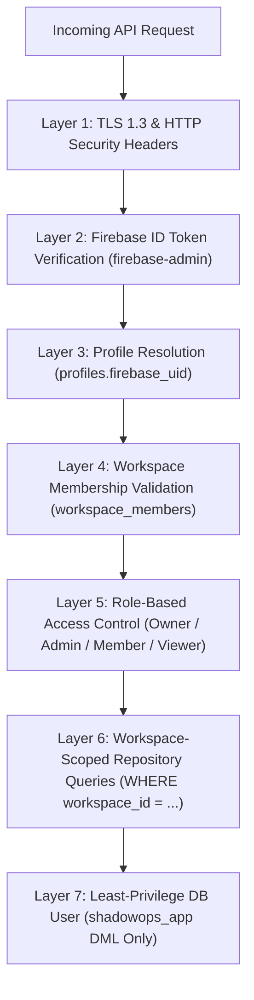

# SHADOWOPS — Enterprise Monorepo

> **"Your AI Security Team. Always Watching."**

ShadowOps is an AI-native cybersecurity SaaS platform designed specifically for fast-moving startups and enterprise engineering teams. It transforms reactive vulnerability management into an autonomous, proactive security lifecycle: discovering attack surfaces, conducting deep static and dependency scans, correlating vulnerabilities into exploitable attack paths, dispatching multi-agent AI security experts, generating verified code-level remediations with human-in-the-loop safeguards, and empirically verifying that fixes eliminated the risk without breaking production.

---

## 1. Core Platform Capabilities



### 1.1 Asset Inventory & Authorization Guardrails
- **Multi-Type Attack Surface Management:** Catalogs repositories, domains, IP ranges, and cloud assets.
- **Mandatory Authorization Gate:** Enforces the absolute invariant: **`NO AUTHORIZATION → NO SCAN`**. Scanning cannot execute without cryptographically verified asset ownership proof.
- **Environment & Criticality Tagging:** Dynamically tags assets across production, staging, and development with tier-based risk weighting.

### 1.2 Multi-Engine Security Scanning
- **Containerized Semgrep SAST/SCA:** Integrates Semgrep for deep semantic static analysis, software composition analysis (SCA), and secret leakage detection.
- **SARIF Standard Ingestion:** Normalizes findings into standard SARIF schema with automated fingerprint deduplication.
- **Scan Telemetry & Event Streaming:** Real-time log capture (`queued` → `running` → `completed`) with event-level tracking.

### 1.3 Attack Path Graph Synthesis
- **Relational Asset Graph:** Synthesizes directed acyclic graphs (DAG) representing multi-step lateral movement and privilege escalation chains.
- **Deterministic Exploitability Scoring:** Computes composite risk scores using mathematical graph weightings rather than unverified LLM guesses.
- **Blast Radius Analysis:** Identifies critical choke points where fixing a single vulnerability breaks multiple attack paths.

### 1.4 Autonomous AI Security Team
- **Specialized AI Security Personas:**
  - **AppSec Specialist:** Deep code-level vulnerability analysis, CWE/CVE attribution, and secure coding practices.
  - **Cloud Infrastructure Architect:** IAM privileges, network boundaries, and misconfiguration evaluation.
  - **Red Team Adversary:** Simulates real-world threat actors chaining vulnerabilities to achieve remote code execution (RCE) or data exfiltration.
- **Google Gemini 3.1 Flash Lite Orchestration:** Sub-second latency AI consultations with bounded token budgets and strict cost-capping ($2.00 max per run).
- **Immutable Fact Boundary:** AI agents cannot override verified scanner findings or alter severity ratings.

### 1.5 Human-in-the-Loop Automated Remediation
- **Syntax-Aware AST Patching:** Generates unified diffs and code patches tailored to specific file lines.
- **Dual Human Approvals:** Requires authorized workspace administrators to review and sign off before patch application.
- **Cryptographic Rollback Checkpoints:** Captures SHA-256 filesystem snapshots and git commit hashes prior to applying any patch, guaranteeing instant one-click rollback if regressions occur.

### 1.6 Independent Empirical Verification
- **Automated Post-Patch Re-scanning:** Re-executes targeted scanners on patched code to verify vulnerability extinction.
- **Delta Comparison Engine:** Compares baseline vs. post-patch findings to detect new or reintroduced issues.
- **Regression Auditing:** Executes test suites and validates deterministic verification policy verdicts (`VERIFIED_CANDIDATE`, `FAILED`, `INCONCLUSIVE`, `BLOCKED`).

### 1.7 Compliance & Executive Reporting
- **Multi-Format Export Engine:** Produces executive summaries, technical delta reports, and audit packages in PDF, JSON, CSV, and HTML formats.
- **SOC2 & ISO 27001 Mapping:** Correlates findings and remediations against compliance control frameworks.
- **Cryptographic Report Signing:** Signs report payloads with SHA-256 hashes for non-repudiation.

### 1.8 Transactional Outbox & Real-Time Notifications
- **Transactional Outbox Pattern:** Decouples event generation from delivery, guaranteeing zero event loss.
- **Multi-Channel Alerting:** Dispatches notifications via in-app feeds, email adapters, and external webhooks (n8n automations).
- **User Preference Matrix:** Granular filtering to mute low-severity alerts while ensuring critical alerts always pierce through.

### 1.9 Interactive AI Security Chat (Sentinel)
- **Telemetry-Grounded Advisories:** Consults directly with workspace telemetry (findings, attack paths, assets) rather than generic web models.
- **Custom Markdown AST Engine:** Formats bold, italics, underlines, syntax-highlighted code blocks, tables, and lists cleanly without raw syntax leaks.

### 1.10 Enterprise Onboarding & Join Flow
- **Dual-Track Registration:**
  - **Register as Company:** Establishes a new organization, slug, and initial assets.
  - **Register as Employee:** Lists registered companies, submits join requests, and receives assigned roles (`owner`, `admin`, `member`, `viewer`).

---

## 2. Technical Stack Architecture



| Layer | Technologies |
| :--- | :--- |
| **Frontend** | Next.js 14 (App Router), React 18, TypeScript (Strict), Tailwind CSS, Lucide Icons, React Query, Zustand |
| **Backend** | Python 3.11+, FastAPI, SQLAlchemy 2.0 (async), `asyncpg`, Pydantic v2, `structlog` |
| **Database** | Google Cloud SQL for PostgreSQL 16 (Primary) / Supabase PostgreSQL 16 (Supported Dual-Mode) |
| **Data API** | Firebase Data Connect (SQL Connect) with typed GraphQL schemas and `@auth` rules |
| **Identity** | Firebase Authentication (Web SDK + `firebase-admin` JWT verification) |
| **AI Engine** | Google Gemini 3.1 Flash Lite (with xAI Grok provider abstraction) |
| **Code Analysis** | Semgrep SAST/SCA CLI with custom SARIF normalizers |
| **Storage** | Google Cloud Storage / Firebase Storage / Supabase S3-compatible storage |
| **Deployment** | Vercel (Frontend Edge) + Google Cloud Run (Backend API & Semgrep) + Cloud SQL |

---

## 3. Monorepo Directory Structure

```
shadowops/
├── frontend/                     # Next.js 14 App Router application
│   ├── app/                      # Route segments (dashboard, scans, findings, chat, onboarding)
│   ├── components/               # Cyberpunk dark UI design system (cards, badges, modals, charts)
│   ├── lib/                      # Firebase client, API clients, markdown parsers, utils
│   ├── hooks/                    # Custom React hooks (useAuth, useWorkspace, useScan)
│   ├── types/                    # Shared TypeScript interfaces and DTOs
│   ├── .env.example              # Client-safe environment variable reference
│   └── vercel.json               # Frontend HTTP security headers & build configuration
├── backend/                      # Python FastAPI REST API server
│   ├── app/
│   │   ├── api/v1/               # API route controllers (workspaces, scans, findings, ai, etc.)
│   │   ├── core/                 # Configuration (pydantic-settings), structured logging
│   │   ├── db/                   # Async SQLAlchemy session, Cloud SQL connector factory
│   │   ├── models/               # 39 SQLAlchemy ORM relational models
│   │   ├── schemas/              # Pydantic v2 request and response schemas
│   │   ├── repositories/         # Parameterized, workspace-scoped data access layer
│   │   ├── services/             # Business logic (scans, AI team, patches, reports, outbox)
│   │   ├── security/             # Firebase JWT verification, RBAC role guardrails
│   │   ├── ai/                   # Gemini & Grok multi-agent orchestrator
│   │   ├── scanners/             # Semgrep execution abstraction and timeout supervisor
│   │   └── workers/              # Background job processing and event outbox workers
│   ├── tests/                    # 106 automated tests (Pytest, pytest-asyncio, tenant isolation)
│   └── requirements.txt          # Python runtime dependencies
├── dataconnect/                  # Firebase Data Connect (SQL Connect) configuration
│   ├── dataconnect.yaml          # Service definition and Cloud SQL instance mapping
│   ├── schema/schema.gql         # PostgreSQL-mirrored GraphQL schema
│   └── connector/                # Typed client queries and mutations with @auth directives
├── supabase/
│   └── migrations/               # Canonical PostgreSQL migrations (0001 through 0012)
├── scripts/
│   └── migration/                # Cloud SQL migration, export, and verification scripts
│       ├── 01_export_supabase_data.sh # Zero-data-loss export and import utility
│       ├── 02_cloud_sql_schema.sql    # Sanitized 39-table Cloud SQL PostgreSQL schema
│       └── 03_verify_migration.py     # Automated migration integrity verification script
├── docs/                         # Production documentation & migration runbooks
│   ├── VERCEL_DEPLOYMENT.md      # Vercel frontend + Container backend deployment guide
│   ├── CLOUD_SQL_SETUP.md        # Cloud SQL PostgreSQL 16 architecture and IAM guide
│   ├── CLOUD_SQL_MIGRATION_REPORT.md # Migration execution report and compatibility matrix
│   ├── FIREBASE_SQL_CONNECT.md   # Firebase Data Connect architecture & security boundaries
│   ├── FASTAPI_CLOUD_SQL.md      # FastAPI Cloud SQL connector integration guide
│   ├── FIREBASE_MIGRATION_BASELINE.md # Database inventory and pre-migration audit
│   ├── FIREBASE_MIGRATION_TEST_REPORT.md # 106-test verification evidence
│   └── PRODUCTION_CUTOVER_PLAN.md # Controlled cutover and rollback runbook
├── firebase.json                 # Firebase CLI configuration
└── vercel.json                   # Root monorepo Vercel configuration
```

---

## 4. Complete Database Model Inventory (39 Tables)

The ShadowOps transactional schema consists of **39 normalized relational tables** in PostgreSQL:

| Subsystem | Tables |
| :--- | :--- |
| **Identity & Workspaces** | `profiles`, `workspaces`, `workspace_members`, `roles` |
| **Assets & Authorizations** | `assets`, `asset_authorizations` |
| **Scanning & Execution** | `scans`, `scan_events`, `agent_runs` |
| **Findings & Analysis** | `findings`, `finding_evidence`, `risk_assessments`, `finding_ai_analysis` |
| **Attack Paths & Graph** | `security_relationships`, `risk_snapshots`, `attack_paths`, `attack_path_nodes`, `attack_path_edges`, `security_team_runs` |
| **Remediation Lifecycle** | `remediation_proposals`, `remediation_approvals`, `remediation_validations`, `remediation_checkpoints`, `remediation_applications` |
| **Empirical Verification** | `verification_runs`, `verification_jobs`, `verification_comparisons`, `verification_regression_checks`, `verification_reviews` |
| **Governance & Chat** | `reports`, `chat_conversations`, `chat_messages`, `audit_logs` |
| **Event Outbox & Routing** | `notifications`, `event_outbox`, `notification_preferences`, `notification_rules`, `notification_deliveries`, `workflow_runs` |

---

## 5. Security Architecture & Multi-Tenant Isolation

ShadowOps enforces multi-layered defense-in-depth:



1. **Authentication:** Derived exclusively from validated Firebase JWT tokens; user identities cannot be forged in request payloads.
2. **Workspace Isolation:** Every database entity (except global reference `roles`) contains a `workspace_id` foreign key. Repositories automatically enforce `WHERE workspace_id = :ws_id`.
3. **Role Enforcement:**
   - **`owner`:** Complete workspace control, billing, member deletion.
   - **`admin`:** Asset onboarding, scan execution, remediation approvals, report exports.
   - **`member`:** Asset creation, scan execution, remediation proposals.
   - **`viewer`:** Read-only access to findings, reports, and dashboards.
4. **Credential Boundary:** Database passwords, service role keys, and private tokens never cross into client bundles.

---

## 6. Quick Start & Local Development

### 6.1 Prerequisites
- Node.js 18+ & npm 9+
- Python 3.11+ (or Python 3.15)
- Git & Semgrep CLI (optional for live code scans)

### 6.2 Backend Setup
```bash
# 1. Navigate to backend directory
cd backend

# 2. Create and activate virtual environment
python -m venv venv
source venv/bin/activate  # On Windows: venv\Scripts\activate

# 3. Install dependencies
pip install -r requirements.txt

# 4. Configure local environment
cp .env.example .env

# 5. Run automated tests (106 tests)
pytest tests

# 6. Start development server
uvicorn app.main:app --host 127.0.0.1 --port 8000 --reload
```

### 6.3 Frontend Setup
```bash
# 1. Navigate to frontend directory
cd frontend

# 2. Install dependencies
npm install

# 3. Configure environment variables
cp .env.example .env.local

# 4. Verify TypeScript integrity
npm run typecheck

# 5. Start development server
npm run dev
# Accessible at http://localhost:3000
```

---

## 7. Automated Testing & Verification

The platform is fortified by a comprehensive automated test suite in [`backend/tests`](file:///d:/Shreyanshcodes/shadow-ops-v2/backend/tests):

```bash
# Run all unit, integration, and security tests
backend/venv/Scripts/python -m pytest backend/tests

# Run tenant isolation security tests specifically
backend/venv/Scripts/python -m pytest backend/tests/test_tenant_isolation_migration.py
```
- **106 tests passing with 0 failures.**
- Comprehensive coverage across cross-workspace isolation, scanner bounds, AI agent invariants, and remediation rollbacks.

---

## 8. Deployment Guides

- **Vercel Frontend & Container Backend:** [`docs/VERCEL_DEPLOYMENT.md`](file:///d:/Shreyanshcodes/shadow-ops-v2/docs/VERCEL_DEPLOYMENT.md)
- **Google Cloud SQL PostgreSQL Setup:** [`docs/CLOUD_SQL_SETUP.md`](file:///d:/Shreyanshcodes/shadow-ops-v2/docs/CLOUD_SQL_SETUP.md)
- **Firebase Data Connect Architecture:** [`docs/FIREBASE_SQL_CONNECT.md`](file:///d:/Shreyanshcodes/shadow-ops-v2/docs/FIREBASE_SQL_CONNECT.md)
- **FastAPI Cloud SQL Integration:** [`docs/FASTAPI_CLOUD_SQL.md`](file:///d:/Shreyanshcodes/shadow-ops-v2/docs/FASTAPI_CLOUD_SQL.md)
- **Production Cutover Runbook:** [`docs/PRODUCTION_CUTOVER_PLAN.md`](file:///d:/Shreyanshcodes/shadow-ops-v2/docs/PRODUCTION_CUTOVER_PLAN.md)
