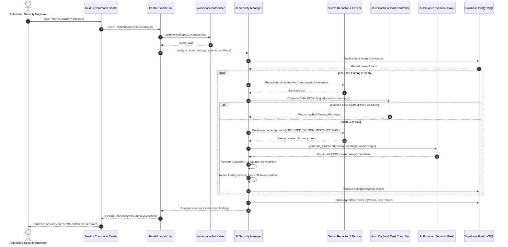

# SHADOWOPS — AI ARCHITECTURE SPECIFICATION
## Stage 4: AI Security Manager & Structured Advisory Layer

```
+-----------------------------------------------------------------------------------+
|                                  SHADOWOPS                                        |
|                          "Your AI Security Team"                                  |
+-----------------------------------------------------------------------------------+
```

---

## 1. Executive Summary & Foundational Trust Hierarchy

ShadowOps incorporates artificial intelligence not as an unchecked autonomous operator, but as an **evidence-grounded, advisory security interpreter**. The system enforces a strict 3-tier data trust hierarchy that guarantees security integrity cannot be compromised by LLM nondeterminism or hallucinations.

```
       ==============================================================
       LEVEL 1: DETERMINISTIC SYSTEM GROUND TRUTH (Highest Authority)
       - Authentication Identity (Firebase Admin)
       - Workspace Multi-Tenant Membership (PostgreSQL RLS)
       - Asset Ownership & Scope Consent (NO AUTHORIZATION -> NO SCAN)
       - Execution Lifecycle State (QUEUED, RUNNING, COMPLETED)
       ==============================================================
                                     |
                                     v
       ==============================================================
       LEVEL 2: TRUSTED SCANNER FACTS & EVIDENCE
       - Semgrep AST Syntactic Rule Matches
       - Fingerprinted Source Code Files & Line Spans
       - Raw Code Snippets & Extracted Tokens
       - Scanner Rule Severity (CRITICAL, HIGH, MEDIUM, LOW)
       ==============================================================
                                     |
                                     v
       ==============================================================
       LEVEL 3: AI SECURITY MANAGER (Advisory Interpretation)
       - Executive Vulnerability Summaries
       - Root-Cause Technical Explanations
       - Contextual Business & Operational Impacts
       - Confidence Scoring (0.0 to 1.0)
       - Advisory Weakness Classification
       - Grounded Evidence Verification
       * CANNOT modify or downgrade Level 1 or Level 2 facts.
       ==============================================================
```

---

## 2. Component Pipeline & Information Flow



---

## 3. Provider Abstraction Layer

The platform abstracts all external LLMs behind a standardized `AIProvider` contract (`backend/app/ai/provider.py`):

```python
class AIProvider(ABC):
    provider_name: str

    @abstractmethod
    async def generate_text(
        self,
        prompt: str,
        system_instruction: Optional[str] = None,
        config: Optional[AIRequestConfig] = None,
    ) -> AITextResponse: ...

    @abstractmethod
    async def generate_structured(
        self,
        prompt: str,
        response_schema: Type[T],
        system_instruction: Optional[str] = None,
        config: Optional[AIRequestConfig] = None,
    ) -> AIStructuredResponse: ...
```

### Supported Providers
1. **Google Gemini (Primary Default)**:
   - Default Model: `gemini-1.5-pro` (configurable via `GEMINI_MODEL`)
   - Protocol: Async HTTP via `httpx` to Google Generative Language API
   - Structured JSON: Enforced via `response_mime_type: "application/json"` and Pydantic `response_schema`
2. **xAI Grok (Adversarial Alternative)**:
   - Default Model: `grok-beta` (configurable via `GROK_MODEL`)
   - Protocol: OpenAI-compatible async chat completion endpoint
   - Structured JSON: Enforced via `response_format: {"type": "json_object"}`

---

## 4. Resilience & Error Boundaries

1. **Exponential Backoff on Rate Limits (HTTP 429 & 5xx)**:
   - Automatic retry up to `AI_MAX_RETRIES` (default 3) with double backoff.
2. **Timeout Envelopes**:
   - Every provider request is bounded by `AI_REQUEST_TIMEOUT_SECONDS` (default 45s).
3. **Execution Traceability**:
   - Every execution creates a persistent row in `agent_runs` logging model used, prompt version, input hash, input/output tokens, and estimated USD cost.
4. **Hermetic Test Isolation**:
   - In test/development mode without paid keys, providers utilize deterministic, schema-validated mock generation that extracts matched AST nodes and line spans without calling third-party networks.
