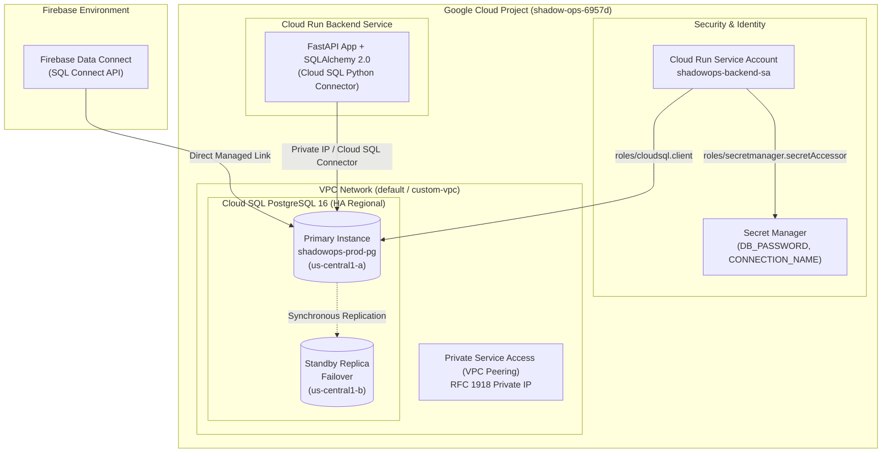

# ShadowOps — Google Cloud SQL for PostgreSQL Setup Guide

**Document Version:** 1.0  
**Target Platform:** Google Cloud SQL for PostgreSQL  
**Engine Version:** PostgreSQL 16  
**Primary Region:** `us-central1` (Iowa, USA)  
**Security Standard:** Google Cloud Well-Architected & Enterprise Security Baseline  

---

## 1. Cloud SQL Architectural Design

ShadowOps utilizes Google Cloud SQL for PostgreSQL as its primary transactional database. The architecture is engineered for multi-tenant data isolation, high availability, point-in-time recovery, zero plain-text credential storage, and least-privilege IAM connectivity.



---

## 2. Environment Specifications

| Parameter | Development | Staging | Production |
| :--- | :--- | :--- | :--- |
| **Instance ID** | `shadowops-dev-pg` | `shadowops-staging-pg` | `shadowops-prod-pg` |
| **Database Engine** | PostgreSQL 16 | PostgreSQL 16 | PostgreSQL 16 |
| **Tier / Machine Type** | `db-custom-1-3840` (1 vCPU, 3.75 GB) | `db-custom-2-7680` (2 vCPU, 7.5 GB) | `db-custom-4-15360` (4 vCPU, 15 GB) |
| **Storage Capacity** | 20 GB SSD (Auto-resize) | 50 GB SSD (Auto-resize) | 100 GB SSD (Auto-resize) |
| **High Availability (HA)** | No (Zonal) | Optional | **Yes (Regional Failover)** |
| **Automated Backups** | Enabled (7 days retention) | Enabled (14 days retention) | **Enabled (30 days retention)** |
| **Point-in-Time Recovery (PITR)** | Disabled | Enabled | **Enabled (WAL Archiving)** |
| **Deletion Protection** | Disabled | Enabled | **Strictly Enabled (`--deletion-protection`)** |
| **Network Type** | Private IP + Auth Proxy | Private IP | **Private IP (Private Service Access)** |
| **SSL/TLS Mode** | `ENCRYPTED_ONLY` | `ENCRYPTED_ONLY` | **`ENCRYPTED_ONLY`** |

---

## 3. Required Google Cloud APIs

Enable the following APIs in project `shadow-ops-6957d`:

```bash
gcloud services enable \
  sqladmin.googleapis.com \
  secretmanager.googleapis.com \
  compute.googleapis.com \
  servicenetworking.googleapis.com \
  run.googleapis.com \
  firebasedataconnect.googleapis.com \
  iam.googleapis.com \
  --project=shadow-ops-6957d
```

---

## 4. Network Configuration: Private Service Access (VPC Peering)

Private connectivity ensures database traffic never traverses the public internet:

```bash
# 1. Allocate an IP range for Google Private Services in the default VPC
gcloud compute addresses create google-managed-services-default \
  --global \
  --purpose=VPC_PEERING \
  --prefix-length=16 \
  --description="Private Service Access for Cloud SQL" \
  --network=default \
  --project=shadow-ops-6957d

# 2. Establish VPC Peering connection with Google services
gcloud services vpc-peerings connect \
  --service=servicenetworking.googleapis.com \
  --ranges=google-managed-services-default \
  --network=default \
  --project=shadow-ops-6957d
```

---

## 5. Instance Provisioning Commands

### 5.1 Production Instance (`shadowops-prod-pg`)
```bash
gcloud sql instances create shadowops-prod-pg \
  --project=shadow-ops-6957d \
  --database-version=POSTGRES_16 \
  --tier=db-custom-4-15360 \
  --region=us-central1 \
  --availability-type=REGIONAL \
  --storage-type=SSD \
  --storage-size=100GB \
  --storage-auto-increase \
  --backup \
  --backup-start-time=03:00 \
  --enable-point-in-time-recovery \
  --retained-backups-count=30 \
  --retained-transaction-log-days=7 \
  --deletion-protection \
  --network=projects/shadow-ops-6957d/global/networks/default \
  --no-assign-ip \
  --database-flags=max_connections=200,statement_timeout=30000,idle_in_transaction_session_timeout=60000,log_checkpoints=on,log_connections=on,log_disconnections=on
```

### 5.2 Staging Instance (`shadowops-staging-pg`)
```bash
gcloud sql instances create shadowops-staging-pg \
  --project=shadow-ops-6957d \
  --database-version=POSTGRES_16 \
  --tier=db-custom-2-7680 \
  --region=us-central1 \
  --availability-type=ZONAL \
  --storage-type=SSD \
  --storage-size=50GB \
  --storage-auto-increase \
  --backup \
  --backup-start-time=04:00 \
  --enable-point-in-time-recovery \
  --retained-backups-count=14 \
  --deletion-protection \
  --network=projects/shadow-ops-6957d/global/networks/default \
  --no-assign-ip \
  --database-flags=max_connections=100,statement_timeout=30000
```

---

## 6. Database Creation & Least-Privilege Users

Create the `shadowops` database and separate operational roles:

```bash
# 1. Create the database
gcloud sql databases create shadowops \
  --instance=shadowops-prod-pg \
  --project=shadow-ops-6957d

# 2. Create the DDL migration user (schema owner)
gcloud sql users create shadowops_migrator \
  --instance=shadowops-prod-pg \
  --project=shadow-ops-6957d \
  --password="GENERATE_STRONG_RANDOM_PASSWORD_MIGRATOR"

# 3. Create the runtime application user (DML only)
gcloud sql users create shadowops_app \
  --instance=shadowops-prod-pg \
  --project=shadow-ops-6957d \
  --password="GENERATE_STRONG_RANDOM_PASSWORD_APP"
```

### Least-Privilege SQL Grants:
Connect as database administrator and enforce RBAC:
```sql
-- Connect to database 'shadowops'
\c shadowops

-- Revoke public permissions
REVOKE ALL ON SCHEMA public FROM PUBLIC;
GRANT USAGE, CREATE ON SCHEMA public TO shadowops_migrator;

-- Grant DML-only permissions to shadowops_app
GRANT USAGE ON SCHEMA public TO shadowops_app;
GRANT SELECT, INSERT, UPDATE, DELETE ON ALL TABLES IN SCHEMA public TO shadowops_app;
GRANT USAGE, SELECT ON ALL SEQUENCES IN SCHEMA public TO shadowops_app;

-- Default privileges for future tables created by the migrator
ALTER DEFAULT PRIVILEGES FOR USER shadowops_migrator IN SCHEMA public
    GRANT SELECT, INSERT, UPDATE, DELETE ON TABLES TO shadowops_app;
ALTER DEFAULT PRIVILEGES FOR USER shadowops_migrator IN SCHEMA public
    GRANT USAGE, SELECT ON SEQUENCES TO shadowops_app;
```

---

## 7. Google Cloud Secret Manager Configuration

Store all sensitive parameters securely in Secret Manager:

```bash
# Create Cloud SQL Connection Name secret
echo -n "shadow-ops-6957d:us-central1:shadowops-prod-pg" | \
  gcloud secrets create shadowops-cloudsql-instance \
    --data-file=- \
    --replication-policy="automatic" \
    --project=shadow-ops-6957d

# Create Database Password secret
echo -n "GENERATE_STRONG_RANDOM_PASSWORD_APP" | \
  gcloud secrets create shadowops-db-password \
    --data-file=- \
    --replication-policy="automatic" \
    --project=shadow-ops-6957d

# Create Full SQLAlchemy Connection URL secret
echo -n "postgresql+asyncpg://shadowops_app:PASSWORD@/shadowops?host=/cloudsql/shadow-ops-6957d:us-central1:shadowops-prod-pg" | \
  gcloud secrets create shadowops-database-url \
    --data-file=- \
    --replication-policy="automatic" \
    --project=shadow-ops-6957d
```

---

## 8. IAM Roles for Backend Service Account

Cloud Run authenticates with Cloud SQL and Secret Manager using a dedicated Google Service Account:

```bash
# 1. Create the backend Service Account
gcloud iam service-accounts create shadowops-backend-sa \
  --display-name="ShadowOps Backend Cloud Run Service Account" \
  --project=shadow-ops-6957d

# 2. Grant Cloud SQL Client permission
gcloud projects add-iam-policy-binding shadow-ops-6957d \
  --member="serviceAccount:shadowops-backend-sa@shadow-ops-6957d.iam.gserviceaccount.com" \
  --role="roles/cloudsql.client"

# 3. Grant Secret Manager Accessor permission
gcloud projects add-iam-policy-binding shadow-ops-6957d \
  --member="serviceAccount:shadowops-backend-sa@shadow-ops-6957d.iam.gserviceaccount.com" \
  --role="roles/secretmanager.secretAccessor"
```

---

## 9. Backup & Disaster Recovery Procedures

### 9.1 On-Demand Backup Before Migration
```bash
gcloud sql backups create \
  --instance=shadowops-prod-pg \
  --description="Pre-migration baseline snapshot" \
  --project=shadow-ops-6957d
```

### 9.2 Point-in-Time Recovery (PITR) Execution
If an errant transaction occurs, restore to an exact timestamp:
```bash
gcloud sql instances clone shadowops-prod-pg shadowops-prod-recovery \
  --point-in-time="2026-10-30T12:00:00.000Z" \
  --project=shadow-ops-6957d
```
