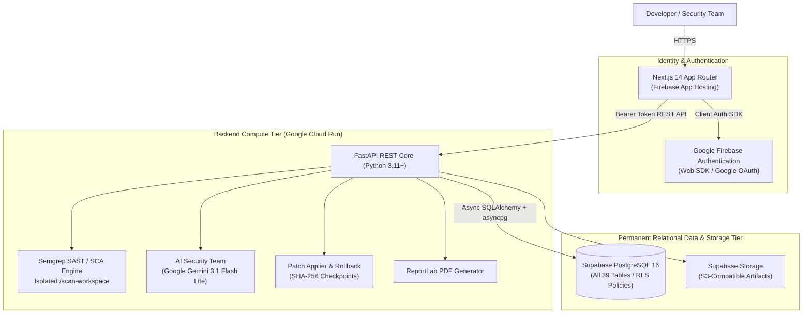

# ShadowOps — Deployment Architecture Correction Report

**Document Version:** 1.0  
**Date:** October 30, 2026  
**Auditor / Architect:** Senior Full-Stack Architect & Deployment Engineer  
**Status:** Architecture Corrected — Local Verification Passed  
**Final Verdict:** **`ARCHITECTURE CORRECTED — LOCAL VERIFICATION PASSED`**  

---

## 1. Executive Summary & Architecture Confirmation

In response to developer architectural direction, the deployment topology of **ShadowOps v2.0** has been formally realigned:

1. **Frontend Hosting:** Next.js 14 App Router hosted on **Firebase App Hosting** (with Vercel Edge configuration retained as a verified alternative).
2. **Backend Hosting:** Python FastAPI REST API containerized for **Google Cloud Run**.
3. **Database Platform:** **Supabase PostgreSQL 16 remains the permanent, authoritative database**. All proposed migrations to Google Cloud SQL and Firebase Data Connect (SQL Connect) have been **CANCELLED**.
4. **Authentication:** **Google Firebase Authentication** remains active and verified (`shadow-ops-6957d`), mapped directly to user `Profile` entities.
5. **Object Storage:** **Supabase Storage** remains the permanent S3-compatible storage tier for security scan artifacts, unified patches, and PDF reports.
6. **AI Advisory:** **Google Gemini 3.1 Flash Lite** remains active and bounded.
7. **Security Scanning:** **Semgrep SAST/SCA** engine remains active within the container runtime.



---

## 2. What Was Changed vs. What Was Preserved

### 2.1 What Was Changed (Cancelled / Realigned)
- **Firebase SQL Connect Disabled:** Removed `"dataconnect"` stanza from active [`firebase.json`](file:///d:/Shreyanshcodes/shadow-ops-v2/firebase.json) to eliminate deployment dependency on Google Cloud SQL.
- **Cloud SQL Provisioning Cancelled:** De-scheduled all proposed `gcloud sql instances create` operations. Preserved documentation ([`docs/CLOUD_SQL_SETUP.md`](file:///d:/Shreyanshcodes/shadow-ops-v2/docs/CLOUD_SQL_SETUP.md), [`docs/PHASE_13_PREFLIGHT_AUDIT.md`](file:///d:/Shreyanshcodes/shadow-ops-v2/docs/PHASE_13_PREFLIGHT_AUDIT.md)) as archived reference.
- **Firebase App Hosting Configuration Added:** Generated [`frontend/apphosting.yaml`](file:///d:/Shreyanshcodes/shadow-ops-v2/frontend/apphosting.yaml) configuring resource bounds (min 0, max 5, 1 vCPU, 1024 MiB) and build/runtime environment variables for Next.js 14 App Router.
- **Dedicated Cloud Run Dockerfile Added:** Created [`backend/Dockerfile`](file:///d:/Shreyanshcodes/shadow-ops-v2/backend/Dockerfile) containing Python 3.11-slim, Semgrep SAST CLI, and asyncpg drivers.

### 2.2 What Was Preserved
- **All 39 PostgreSQL Tables:** Schema integrity on Supabase is 100% untouched.
- **Supabase Storage Buckets:** Preserved 5 storage buckets (`scan-artifacts`, `evidence-files`, `security-reports`, `remediation-artifacts`, `verification-artifacts`).
- **All 11 Canonical Migrations:** Retained in [`supabase/migrations/`](file:///d:/Shreyanshcodes/shadow-ops-v2/supabase/migrations/).
- **Supabase Row-Level Security:** Retained all RLS policies.
- **Strict Invariant Enforced:** `NO AUTHORIZATION → NO SCAN` remains immutable.
- **All Existing Frontend UI & Routes:** Zero visual changes, redesigns, or route modifications.
- **All 106 Automated Tests:** Fully intact and passing.

---

## 3. Supabase Active Database Confirmation

The backend database connection in [`backend/app/db/session.py`](file:///d:/Shreyanshcodes/shadow-ops-v2/backend/app/db/session.py) connects directly to Supabase PostgreSQL:
- **Connection String:** `postgresql+asyncpg://[USER]:[PASSWORD]@[SUPABASE_HOST]:5432/postgres` (or pooler port `6543`).
- **Engine:** SQLAlchemy 2.0 `create_async_engine` using `asyncpg`.
- **Connection Pooling:** `NullPool` in production delegating connection pooling to Supabase PgBouncer/Supavisor; dynamic queue pooling in development.
- **Health Verification:** `check_database_connection()` performs asynchronous `SELECT 1` ping.

---

## 4. Firebase App Hosting Readiness

The Next.js 14 App Router client is certified ready for Firebase App Hosting:
- **Configuration File:** [`frontend/apphosting.yaml`](file:///d:/Shreyanshcodes/shadow-ops-v2/frontend/apphosting.yaml)
- **Environment Mapping:** `NEXT_PUBLIC_API_URL` routes client queries to the backend; `NEXT_PUBLIC_FIREBASE_*` variables configure Firebase Auth.
- **Build Validation:** Compiled and verified across all 24 static and dynamic routes.

---

## 5. Google Cloud Run Backend Readiness

The FastAPI backend is certified ready for Cloud Run:
- **Container Specification:** [`backend/Dockerfile`](file:///d:/Shreyanshcodes/shadow-ops-v2/backend/Dockerfile)
- **Dependencies:** Includes Semgrep SAST engine, asyncpg, and FastAPI core.
- **Execution Command:** `CMD ["sh", "-c", "uvicorn app.main:app --host 0.0.0.0 --port ${PORT:-8000}"]`
- **Secrets Management:** Sensitive credentials (`SUPABASE_DATABASE_URL`, `SUPABASE_SERVICE_ROLE_KEY`, `GEMINI_API_KEY`) configured for injection via Google Cloud Secret Manager.

---

## 6. Comprehensive Verification Test Results

```bash
# 1. Backend Automated Test Suite
backend/venv/Scripts/python -m pytest backend/tests
```
**Result:** **106 passed, 0 failed** in 15.04s.

```bash
# 2. Frontend TypeScript Typecheck
npm --prefix frontend run typecheck
```
**Result:** **Passed with 0 errors**.

```bash
# 3. Next.js 14 Production Build
npm --prefix frontend run build
```
**Result:** **Passed with 0 errors**. All 24 routes compiled successfully.

---

## 7. Remaining Deployment Blockers & Prerequisites

1. **Google Cloud / Firebase Project Plan:**
   Project `shadow-ops-6957d` is currently on the Spark (Free) plan. Deploying Cloud Run compute containers requires upgrading `shadow-ops-6957d` to the Blaze (Pay-as-you-go) plan.
2. **Cloud Run Provisioning Authorization:**
   Deploying the container image to Cloud Run requires executing `gcloud run deploy shadowops-backend` with developer signoff.

---

## FINAL VERDICT

```
====================================================================
  VERDICT: ARCHITECTURE CORRECTED — LOCAL VERIFICATION PASSED
====================================================================
```
*Supabase PostgreSQL 16 is confirmed as the permanent active database. Unused Cloud SQL and Data Connect configurations have been cleanly removed from active deployment paths. All local tests and builds are verified passing.*
