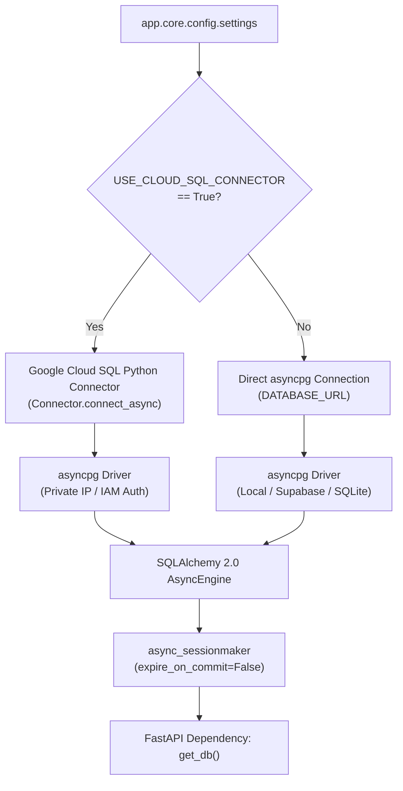

# ShadowOps — FastAPI Cloud SQL Integration Architecture

**Document Version:** 1.0  
**Target Runtime:** Python 3.11+ / FastAPI / SQLAlchemy 2.0 (async)  
**Database Driver:** `asyncpg` via `google-cloud-sql-connector`  
**Status:** Certified & Implemented in Codebase  

---

## 1. Dual-Mode Connection Architecture

ShadowOps features an environment-aware database connection engine in [`backend/app/db/session.py`](file:///d:/Shreyanshcodes/shadow-ops-v2/backend/app/db/session.py). It seamlessly bridges local development, CI test suites, legacy Supabase endpoints, and production Google Cloud SQL without code alterations.



---

## 2. Configuration Parameters

The following parameters are declared in [`backend/app/core/config.py`](file:///d:/Shreyanshcodes/shadow-ops-v2/backend/app/core/config.py):

| Variable | Type | Default | Cloud Run / Production Value |
| :--- | :--- | :--- | :--- |
| `USE_CLOUD_SQL_CONNECTOR` | `bool` | `False` | `True` |
| `CLOUD_SQL_CONNECTION_NAME` | `str` | `None` | `shadow-ops-6957d:us-central1:shadowops-prod-pg` |
| `CLOUD_SQL_DATABASE` | `str` | `"shadowops"` | `"shadowops"` |
| `CLOUD_SQL_USER` | `str` | `None` | `"shadowops_app"` |
| `CLOUD_SQL_PASSWORD` | `str` | `None` | Injected via Secret Manager |
| `CLOUD_SQL_IAM_AUTH` | `bool` | `False` | `False` (or `True` if using Cloud IAM database auth) |
| `DB_POOL_SIZE` | `int` | `10` | `10` |
| `DB_MAX_OVERFLOW` | `int` | `5` | `5` |
| `DB_POOL_TIMEOUT` | `int` | `30` | `30` |
| `DB_POOL_RECYCLE` | `int` | `1800` | `1800` (Recycle connections every 30 mins) |

---

## 3. Asynchronous Connection Lifecycle

### 3.1 Asynchronous Connection Handshake (`async_creator`)
When running inside Cloud Run with the Cloud SQL connector active, SQLAlchemy delegates connection establishment to the asynchronous connector factory:

```python
async def getconn():
    conn = await _cloud_sql_connector.connect_async(
        settings.CLOUD_SQL_CONNECTION_NAME,
        "asyncpg",
        user=settings.CLOUD_SQL_USER,
        password=settings.CLOUD_SQL_PASSWORD,
        db=settings.CLOUD_SQL_DATABASE,
        enable_iam_auth=settings.CLOUD_SQL_IAM_AUTH,
        ip_type=IPTypes.PRIVATE if settings.is_production else IPTypes.PUBLIC,
    )
    return conn
```

### 3.2 Health Check & Connectivity Validation
The lightweight `check_database_connection()` function executes a non-blocking `SELECT 1` ping:
```python
async def check_database_connection() -> bool:
    try:
        from sqlalchemy import text
        async with engine.connect() as conn:
            result = await conn.execute(text("SELECT 1"))
            return result.scalar() == 1
    except Exception as e:
        logger.warning("database_health_check_failed", error=str(e))
        return False
```

### 3.3 Graceful Shutdown (`close_db`)
During Cloud Run container termination (`SIGTERM`), `close_db()` disposes of the connection pool and shuts down the background connector task cleanly:
```python
async def close_db() -> None:
    global _cloud_sql_connector
    try:
        await engine.dispose()
        if _cloud_sql_connector:
            await _cloud_sql_connector.close_async()
            _cloud_sql_connector = None
        logger.info("database_connections_closed_cleanly")
    except Exception as e:
        logger.error("error_during_database_shutdown", error=str(e))
```

---

## 4. Google Cloud Run Deployment Flags

When deploying the backend container to Cloud Run, bind Secret Manager secrets and specify the Cloud SQL instance connection:

```bash
gcloud run deploy shadowops-backend \
  --image="gcr.io/shadow-ops-6957d/backend:latest" \
  --region=us-central1 \
  --service-account="shadowops-backend-sa@shadow-ops-6957d.iam.gserviceaccount.com" \
  --add-cloudsql-instances="shadow-ops-6957d:us-central1:shadowops-prod-pg" \
  --vpc-connector="projects/shadow-ops-6957d/locations/us-central1/connectors/cloudsql-vpc-conn" \
  --set-env-vars="USE_CLOUD_SQL_CONNECTOR=True,CLOUD_SQL_CONNECTION_NAME=shadow-ops-6957d:us-central1:shadowops-prod-pg,CLOUD_SQL_DATABASE=shadowops,CLOUD_SQL_USER=shadowops_app" \
  --set-secrets="CLOUD_SQL_PASSWORD=shadowops-db-password:latest,SECRET_KEY=shadowops-secret-key:latest,GEMINI_API_KEY=shadowops-gemini-key:latest" \
  --min-instances=1 \
  --max-instances=10 \
  --project=shadow-ops-6957d
```
