# ShadowOps — Database Migration Baseline Audit

**Document Version:** 1.0  
**Date:** October 30, 2026  
**Auditor:** Senior Google Cloud Architect & Application Security Engineer  
**Status:** Certified Baseline Audit  

---

## 1. Executive Summary

ShadowOps v2.0 is an enterprise-grade AI-native cybersecurity SaaS platform. The application is currently backed by a multi-tenant PostgreSQL database hosted on Supabase (PostgreSQL 16), utilizing Firebase Authentication for identity token issuance and verification, with an async Python FastAPI backend handling API routing, security scanning orchestration (Semgrep), AI security agents (Gemini 3.1 Flash Lite), attack path graph synthesis, remediation patch generation, and empirical verification.

This document establishes the official **pre-migration architectural baseline** required to safely execute the migration from Supabase PostgreSQL to **Google Cloud SQL for PostgreSQL** with **Firebase Data Connect (SQL Connect)**, in strict compliance with the project's zero-downtime, zero-data-loss, and non-negotiable security mandates.

---

## 2. Existing Database Architecture

### 2.1 Engine & Platform
- **Current Database Host:** Supabase Cloud PostgreSQL 16.x.
- **Connection Protocols:**
  - Application Runtime: Direct async connection via `asyncpg` (`postgresql+asyncpg://...`) using SQLAlchemy 2.0 async engine.
  - Connection Pooling: Application-side SQLAlchemy `NullPool` in production (delegating pooling to Supabase PgBouncer/Supavisor on port 6543) and dynamic pooling in development.
  - Management / DDL: Supabase CLI and SQL migration runner.

### 2.2 PostgreSQL Extensions in Use
| Extension | Purpose | Supabase Status | Cloud SQL PostgreSQL Status | Compatibility Verdict |
| :--- | :--- | :--- | :--- | :--- |
| `uuid-ossp` | UUID generation (`uuid_generate_v4()`) | Enabled | Fully supported | **100% Compatible** |
| `pgcrypto` | Cryptographic functions & UUIDs (`gen_random_uuid()`) | Enabled | Fully supported | **100% Compatible** |

---

## 3. Complete Table Inventory (39 Tables)

The ShadowOps schema consists of **39 canonical tables** spanning authentication, tenant isolation, asset inventory, scanning pipelines, AI agent telemetry, attack graph analysis, remediation lifecycle, verification engine, compliance reporting, and notification outbox.

```mermaid
erDiagram
    profiles ||--o{ workspaces : owns
    profiles ||--o{ workspace_members : participates
    workspaces ||--o{ workspace_members : contains
    workspaces ||--o{ assets : owns
    assets ||--o{ asset_authorizations : authorizes
    workspaces ||--o{ scans : runs
    scans ||--o{ scan_events : produces
    scans ||--o{ agent_runs : executes
    workspaces ||--o{ findings : records
    findings ||--o{ finding_evidence : contains
    findings ||--o{ risk_assessments : evaluates
    findings ||--o{ finding_ai_analysis : enriched_by
    workspaces ||--o{ security_relationships : maps
    workspaces ||--o{ attack_paths : identifies
    attack_paths ||--o{ attack_path_nodes : contains
    attack_paths ||--o{ attack_path_edges : links
    workspaces ||--o{ remediation_proposals : manages
    remediation_proposals ||--o{ remediation_approvals : requires
    remediation_proposals ||--o{ remediation_validations : undergoes
    remediation_proposals ||--o{ remediation_checkpoints : snapshots
    remediation_proposals ||--o{ remediation_applications : tracks
    workspaces ||--o{ verification_jobs : runs
    verification_jobs ||--o{ verification_comparisons : validates
    verification_jobs ||--o{ verification_regression_checks : audits
    verification_jobs ||--o{ verification_reviews : logs
    workspaces ||--o{ reports : publishes
    workspaces ||--o{ chat_conversations : hosts
    chat_conversations ||--o{ chat_messages : contains
    workspaces ||--o{ audit_logs : logs
    workspaces ||--o{ notifications : delivers
    workspaces ||--o{ event_outbox : queues
    workspaces ||--o{ workflow_runs : automates
```

### 3.1 Tenant Identity & Access Control
1. **`profiles`**
   - **Primary Key:** `id` (UUID, default `gen_random_uuid()`).
   - **Unique Columns:** `firebase_uid` (TEXT, unique index).
   - **Columns:** `email` (TEXT), `display_name` (TEXT), `avatar_url` (TEXT), `role` (TEXT: `'user'`, `'admin'`), `created_at`, `updated_at`, `last_login_at`.
   - **Relationships:** Referenced by `workspaces.owner_id`, `workspace_members.user_id`, `audit_logs.user_id`, `notifications.user_id`.
2. **`workspaces`**
   - **Primary Key:** `id` (UUID).
   - **Unique Columns:** `slug` (TEXT).
   - **Foreign Keys:** `owner_id` -> `profiles(id)`.
   - **Columns:** `name` (TEXT), `plan` (TEXT), `settings` (JSONB), `created_at`, `updated_at`, `deleted_at`.
3. **`workspace_members`**
   - **Primary Key:** `id` (UUID).
   - **Unique Constraint:** `(workspace_id, user_id)`.
   - **Foreign Keys:** `workspace_id` -> `workspaces(id)` ON DELETE CASCADE, `user_id` -> `profiles(id)` ON DELETE CASCADE, `invited_by` -> `profiles(id)`.
   - **Columns:** `role` (TEXT: `'owner'`, `'admin'`, `'member'`, `'viewer'`), `invited_at`, `joined_at`, `created_at`.
4. **`roles`** (Reference table)
   - **Primary Key:** `id` (TEXT: `'owner'`, `'admin'`, `'member'`, `'viewer'`).
   - **Columns:** `name` (TEXT), `permissions` (JSONB), `description` (TEXT).

### 3.2 Asset Discovery & Authorization
5. **`assets`**
   - **Primary Key:** `id` (UUID).
   - **Foreign Keys:** `workspace_id` -> `workspaces(id)` ON DELETE CASCADE, `created_by` -> `profiles(id)`.
   - **Columns:** `name` (TEXT), `type` (TEXT: `'repo'`, `'domain'`, `'ip'`, `'cloud'`), `target` (TEXT), `environment` (TEXT), `criticality` (TEXT: `'critical'`, `'high'`, `'medium'`, `'low'`), `is_active` (BOOLEAN), `metadata` (JSONB).
6. **`asset_authorizations`**
   - **Primary Key:** `id` (UUID).
   - **Foreign Keys:** `asset_id` -> `assets(id)` ON DELETE CASCADE, `workspace_id` -> `workspaces(id)` ON DELETE CASCADE, `authorized_by` -> `profiles(id)`.
   - **Columns:** `status` (TEXT: `'pending'`, `'verified'`, `'rejected'`, `'expired'`), `evidence_type` (TEXT), `evidence_payload` (JSONB), `verified_at` (TIMESTAMPTZ), `expires_at` (TIMESTAMPTZ).

### 3.3 Security Scanning Engine
7. **`scans`**
   - **Primary Key:** `id` (UUID).
   - **Foreign Keys:** `workspace_id` -> `workspaces(id)` ON DELETE CASCADE, `asset_id` -> `assets(id)` ON DELETE CASCADE, `initiated_by` -> `profiles(id)`.
   - **Columns:** `scan_type` (TEXT), `status` (TEXT: `'queued'`, `'running'`, `'completed'`, `'failed'`, `'cancelled'`), `summary` (JSONB), `started_at`, `completed_at`, `error_message` (TEXT).
8. **`scan_events`**
   - **Primary Key:** `id` (UUID).
   - **Foreign Keys:** `scan_id` -> `scans(id)` ON DELETE CASCADE, `workspace_id` -> `workspaces(id)` ON DELETE CASCADE.
   - **Columns:** `event_type` (TEXT), `level` (TEXT), `message` (TEXT), `payload` (JSONB), `created_at`.
9. **`agent_runs`**
   - **Primary Key:** `id` (UUID).
   - **Foreign Keys:** `scan_id` -> `scans(id)` ON DELETE CASCADE, `workspace_id` -> `workspaces(id)` ON DELETE CASCADE.
   - **Columns:** `agent_name` (TEXT), `status` (TEXT), `inputs` (JSONB), `outputs` (JSONB), `cost_estimate_usd` (NUMERIC), `duration_ms` (INT).

### 3.4 Findings & Vulnerability Telemetry
10. **`findings`**
    - **Primary Key:** `id` (UUID).
    - **Foreign Keys:** `workspace_id` -> `workspaces(id)`, `asset_id` -> `assets(id)`, `scan_id` -> `scans(id)`.
    - **Columns:** `title` (TEXT), `description` (TEXT), `severity` (TEXT: `'critical'`, `'high'`, `'medium'`, `'low'`, `'info'`), `status` (TEXT: `'open'`, `'remediated'`, `'false_positive'`, `'accepted'`), `cwe_id` (TEXT), `cve_id` (TEXT), `raw_finding` (JSONB), `line_number` (INT), `file_path` (TEXT).
11. **`finding_evidence`**
    - **Primary Key:** `id` (UUID).
    - **Foreign Keys:** `finding_id` -> `findings(id)` ON DELETE CASCADE, `workspace_id` -> `workspaces(id)`.
    - **Columns:** `evidence_type` (TEXT), `data` (JSONB), `created_at`.
12. **`risk_assessments`**
    - **Primary Key:** `id` (UUID).
    - **Foreign Keys:** `finding_id` -> `findings(id)` ON DELETE CASCADE, `workspace_id` -> `workspaces(id)`.
    - **Columns:** `score` (NUMERIC), `vector` (TEXT), `factors` (JSONB), `assessed_by` (TEXT).
13. **`finding_ai_analysis`**
    - **Primary Key:** `id` (UUID).
    - **Foreign Keys:** `finding_id` -> `findings(id)` ON DELETE CASCADE, `workspace_id` -> `workspaces(id)`.
    - **Columns:** `analysis_text` (TEXT), `suggested_fix` (TEXT), `confidence_score` (NUMERIC), `model_used` (TEXT), `tokens_used` (INT).

### 3.5 Attack Path Synthesis & Graph Analytics
14. **`security_relationships`**
    - **Primary Key:** `id` (UUID).
    - **Foreign Keys:** `workspace_id` -> `workspaces(id)` ON DELETE CASCADE, `source_id` -> `assets(id)`, `target_id` -> `assets(id)`.
    - **Columns:** `relationship_type` (TEXT), `attributes` (JSONB), `confidence` (NUMERIC).
15. **`risk_snapshots`**
    - **Primary Key:** `id` (UUID).
    - **Foreign Keys:** `workspace_id` -> `workspaces(id)` ON DELETE CASCADE.
    - **Columns:** `risk_score` (NUMERIC), `total_findings` (INT), `critical_findings` (INT), `attack_paths_count` (INT), `metadata` (JSONB), `created_at`.
16. **`attack_paths`**
    - **Primary Key:** `id` (UUID).
    - **Foreign Keys:** `workspace_id` -> `workspaces(id)` ON DELETE CASCADE.
    - **Columns:** `title` (TEXT), `description` (TEXT), `severity` (TEXT), `exploitability_score` (NUMERIC), `status` (TEXT), `created_at`.
17. **`attack_path_nodes`**
    - **Primary Key:** `id` (UUID).
    - **Foreign Keys:** `attack_path_id` -> `attack_paths(id)` ON DELETE CASCADE, `workspace_id` -> `workspaces(id)`.
    - **Columns:** `node_type` (TEXT), `reference_id` (UUID), `label` (TEXT), `order_index` (INT).
18. **`attack_path_edges`**
    - **Primary Key:** `id` (UUID).
    - **Foreign Keys:** `attack_path_id` -> `attack_paths(id)` ON DELETE CASCADE, `source_node_id` -> `attack_path_nodes(id)`, `target_node_id` -> `attack_path_nodes(id)`.
    - **Columns:** `relationship` (TEXT), `weight` (NUMERIC).
19. **`security_team_runs`**
    - **Primary Key:** `id` (UUID).
    - **Foreign Keys:** `workspace_id` -> `workspaces(id)` ON DELETE CASCADE.
    - **Columns:** `agents_executed` (TEXT[]), `findings_evaluated` (INT), `recommendations` (JSONB), `created_at`.

### 3.6 Automated Remediation & Rollback Engine
20. **`remediation_proposals`**
    - **Primary Key:** `id` (UUID).
    - **Foreign Keys:** `finding_id` -> `findings(id)`, `workspace_id` -> `workspaces(id)`.
    - **Columns:** `title` (TEXT), `explanation` (TEXT), `diff_content` (TEXT), `fix_type` (TEXT), `status` (TEXT: `'draft'`, `'proposed'`, `'approved'`, `'rejected'`, `'applied'`, `'reverted'`).
21. **`remediation_approvals`**
    - **Primary Key:** `id` (UUID).
    - **Foreign Keys:** `proposal_id` -> `remediation_proposals(id)` ON DELETE CASCADE, `approved_by` -> `profiles(id)`.
    - **Columns:** `decision` (TEXT: `'approved'`, `'rejected'`), `comments` (TEXT), `decided_at` (TIMESTAMPTZ).
22. **`remediation_validations`**
    - **Primary Key:** `id` (UUID).
    - **Foreign Keys:** `proposal_id` -> `remediation_proposals(id)` ON DELETE CASCADE, `workspace_id` -> `workspaces(id)`.
    - **Columns:** `syntax_valid` (BOOLEAN), `tests_passed` (BOOLEAN), `validation_logs` (TEXT), `created_at`.
23. **`remediation_checkpoints`**
    - **Primary Key:** `id` (UUID).
    - **Foreign Keys:** `proposal_id` -> `remediation_proposals(id)` ON DELETE CASCADE, `workspace_id` -> `workspaces(id)`.
    - **Columns:** `git_commit_sha` (TEXT), `snapshot_sha256` (TEXT), `rollback_payload` (JSONB), `created_at`.
24. **`remediation_applications`**
    - **Primary Key:** `id` (UUID).
    - **Foreign Keys:** `proposal_id` -> `remediation_proposals(id)` ON DELETE CASCADE, `applied_by` -> `profiles(id)`.
    - **Columns:** `status` (TEXT), `applied_at` (TIMESTAMPTZ), `reverted_at` (TIMESTAMPTZ), `logs` (TEXT).

### 3.7 Independent Verification & Regression Auditing
25. **`verification_runs`** (Legacy stage 1 verification table)
    - **Primary Key:** `id` (UUID).
    - **Foreign Keys:** `proposal_id` -> `remediation_proposals(id)`, `workspace_id` -> `workspaces(id)`.
26. **`verification_jobs`** (Stage 9 enterprise verification runner)
    - **Primary Key:** `id` (UUID).
    - **Foreign Keys:** `workspace_id` -> `workspaces(id)` ON DELETE CASCADE, `remediation_id` -> `remediation_proposals(id)`.
    - **Columns:** `status` (TEXT), `policy_verdict` (TEXT: `'VERIFIED_CANDIDATE'`, `'FAILED'`, `'INCONCLUSIVE'`, `'BLOCKED'`), `policy_version` (TEXT), `policy_reasons` (JSONB).
27. **`verification_comparisons`**
    - **Primary Key:** `id` (UUID).
    - **Foreign Keys:** `verification_job_id` -> `verification_jobs(id)` ON DELETE CASCADE, `workspace_id` -> `workspaces(id)`.
    - **Columns:** `baseline_finding_count` (INT), `reverified_finding_count` (INT), `eliminated_findings` (UUID[]), `new_findings` (UUID[]), `comparison_summary` (JSONB).
28. **`verification_regression_checks`**
    - **Primary Key:** `id` (UUID).
    - **Foreign Keys:** `verification_job_id` -> `verification_jobs(id)` ON DELETE CASCADE, `workspace_id` -> `workspaces(id)`.
    - **Columns:** `test_suite_status` (TEXT), `regressions_detected` (INT), `details` (JSONB).
29. **`verification_reviews`**
    - **Primary Key:** `id` (UUID).
    - **Foreign Keys:** `verification_job_id` -> `verification_jobs(id)` ON DELETE CASCADE, `reviewed_by` -> `profiles(id)`.
    - **Columns:** `decision` (TEXT), `review_notes` (TEXT), `reviewed_at` (TIMESTAMPTZ).

### 3.8 Governance, AI Consultation, and Notifications
30. **`reports`**
    - **Primary Key:** `id` (UUID).
    - **Foreign Keys:** `workspace_id` -> `workspaces(id)` ON DELETE CASCADE, `generated_by` -> `profiles(id)`.
    - **Columns:** `title` (TEXT), `report_type` (TEXT), `format` (TEXT), `storage_object_id` (UUID), `metadata` (JSONB).
31. **`chat_conversations`**
    - **Primary Key:** `id` (UUID).
    - **Foreign Keys:** `workspace_id` -> `workspaces(id)` ON DELETE CASCADE, `user_id` -> `profiles(id)`.
    - **Columns:** `title` (TEXT), `context_type` (TEXT), `context_id` (UUID), `message_count` (INT).
32. **`chat_messages`**
    - **Primary Key:** `id` (UUID).
    - **Foreign Keys:** `conversation_id` -> `chat_conversations(id)` ON DELETE CASCADE, `workspace_id` -> `workspaces(id)`.
    - **Columns:** `role` (TEXT), `content` (TEXT), `citations` (UUID[]), `model_used` (TEXT), `tokens_input` (INT), `tokens_output` (INT).
33. **`audit_logs`** (Append-only immutable audit trail)
    - **Primary Key:** `id` (BIGSERIAL).
    - **Foreign Keys:** `workspace_id` -> `workspaces(id)` ON DELETE CASCADE, `user_id` -> `profiles(id)` ON DELETE SET NULL.
    - **Columns:** `action` (TEXT), `resource_type` (TEXT), `resource_id` (UUID), `old_state` (JSONB), `new_state` (JSONB), `ip_address` (INET), `user_agent` (TEXT), `request_id` (UUID).
34. **`notifications`**
    - **Primary Key:** `id` (UUID).
    - **Foreign Keys:** `workspace_id` -> `workspaces(id)` ON DELETE CASCADE, `user_id` -> `profiles(id)` ON DELETE CASCADE.
    - **Columns:** `type` (TEXT), `title` (TEXT), `message` (TEXT), `read_at` (TIMESTAMPTZ), `sent_at` (TIMESTAMPTZ).
35. **`event_outbox`** (Transactional outbox pattern)
    - **Primary Key:** `id` (UUID).
    - **Foreign Keys:** `workspace_id` -> `workspaces(id)` ON DELETE CASCADE.
    - **Columns:** `event_name` (TEXT), `payload` (JSONB), `status` (TEXT: `'pending'`, `'processing'`, `'delivered'`, `'failed'`), `retry_count` (INT).
36. **`notification_preferences`**
    - **Primary Key:** `id` (UUID).
    - **Foreign Keys:** `workspace_id` -> `workspaces(id)` ON DELETE CASCADE, `user_id` -> `profiles(id)` ON DELETE CASCADE.
    - **Columns:** `channels` (JSONB), `mute_low_severity` (BOOLEAN).
37. **`notification_rules`**
    - **Primary Key:** `id` (UUID).
    - **Foreign Keys:** `workspace_id` -> `workspaces(id)` ON DELETE CASCADE.
    - **Columns:** `event_filter` (TEXT), `target_channel` (TEXT), `is_active` (BOOLEAN).
38. **`notification_deliveries`**
    - **Primary Key:** `id` (UUID).
    - **Foreign Keys:** `outbox_id` -> `event_outbox(id)` ON DELETE CASCADE, `workspace_id` -> `workspaces(id)`.
    - **Columns:** `destination` (TEXT), `response_code` (INT), `delivered_at` (TIMESTAMPTZ).
39. **`workflow_runs`** (n8n & external automation executions)
    - **Primary Key:** `id` (UUID).
    - **Foreign Keys:** `workspace_id` -> `workspaces(id)` ON DELETE CASCADE.
    - **Columns:** `workflow_name` (TEXT), `status` (TEXT), `input_data` (JSONB), `output_data` (JSONB).

---

## 4. Migration Inventory

The repository contains 11 canonical migration files:

| Migration File | Description | Core Tables / Features |
| :--- | :--- | :--- |
| `0001_initial_schema.sql` | Foundation schema | 23 initial tables, extensions, update trigger, RLS enablement |
| `0003_stage3_scanning.sql` | Scanning events & telemetry | Indexes, `scans` RLS policy, `scan_events` RLS policy |
| `0004_stage4_ai.sql` | AI findings analysis | `finding_ai_analysis` table, RLS policy |
| `0005_stage5_ai_analyst.sql` | AI chat & prompt versioning | Chat enhancements, token metrics |
| `0006_stage6_attack_paths.sql` | Graph relationships & attack paths | `security_relationships`, `risk_snapshots`, RLS policies |
| `0007_stage7_ai_security_team.sql` | Multi-agent orchestrator | `security_team_runs`, RLS policy |
| `0008_stage8_remediation.sql` | Automated remediation lifecycle | `remediation_validations`, `remediation_checkpoints`, `remediation_applications` |
| `0009_stage9_verification.sql` | Empirical verification engine | `verification_jobs`, `verification_comparisons`, `verification_regression_checks`, `verification_reviews` |
| `0010_stage10_reports.sql` | Compliance reporting | Report templates, export formats |
| `0011_stage11_notifications.sql` | Transactional outbox & webhooks | `event_outbox`, `notification_rules`, `notification_deliveries`, `workflow_runs` |
| `0012_storage.sql` | Supabase storage bucket specification | 5 storage buckets (`scan-artifacts`, `evidence-files`, etc.), storage RLS |

---

## 5. RLS Policy Inventory & Analysis

In Supabase, Row-Level Security was enabled across all tables. The following explicit policies were created:
1. `scans` (`workspace_isolation_scans`):
   `USING (EXISTS (SELECT 1 FROM workspace_members WHERE workspace_id = scans.workspace_id AND user_id = auth.uid()))`
2. `scan_events` (`workspace_isolation_scan_events`):
   `USING (EXISTS (SELECT 1 FROM workspace_members WHERE workspace_id = scan_events.workspace_id AND user_id = auth.uid()))`
3. `finding_ai_analysis` (`workspace_isolation_finding_ai_analysis`):
   `USING (EXISTS (SELECT 1 FROM workspace_members WHERE workspace_id = finding_ai_analysis.workspace_id AND user_id = auth.uid()))`
4. `security_relationships` (`security_relationships_workspace_isolation`):
   `USING (EXISTS (SELECT 1 FROM workspace_members WHERE workspace_id = security_relationships.workspace_id AND user_id = auth.uid()))`
5. `risk_snapshots` (`risk_snapshots_workspace_isolation`):
   `USING (EXISTS (SELECT 1 FROM workspace_members WHERE workspace_id = risk_snapshots.workspace_id AND user_id = auth.uid()))`
6. `security_team_runs` (`security_team_runs_workspace_isolation`):
   `USING (EXISTS (SELECT 1 FROM workspace_members WHERE workspace_id = security_team_runs.workspace_id AND user_id = auth.uid()))`
7. `storage.objects` (`workspace_members_read_storage`, `service_role_and_admins_insert_storage`):
   Policies based on `(string_to_array(name, '/'))[1]::uuid` and `auth.uid()`.

### Crucial Security Finding:
- **`auth.uid()` Dependency:** In Supabase, `auth.uid()` resolves the calling user from the Supabase JWT header (`role: authenticated`).
- In Cloud SQL PostgreSQL, `auth.uid()` is **not a built-in function**.
- In the ShadowOps application architecture, **all database access is executed server-side through the FastAPI backend via SQLAlchemy repositories**.
- The backend already authenticates requests using **Firebase Authentication ID tokens**, maps claims to `Profile`, validates `WorkspaceMember` membership in dependencies, and scopes every database query by `workspace_id`.
- Therefore, in Cloud SQL, tenant isolation is primarily enforced through **strict application-level scoping, parameterized repository methods, and Firebase Data Connect `@auth` directive enforcement**, creating defense-in-depth without relying on Supabase-proprietary SQL functions.

---

## 6. All Supabase-Specific Dependencies

1. **`auth.uid()` and `auth.role()`:** Used only in Supabase SQL migration policies. Must be replaced with application-layer security + Firebase Data Connect GraphQL auth directives.
2. **`storage.buckets` and `storage.objects`:** Supabase internal storage schema. ShadowOps files (PDF reports, patch diffs, scan artifacts) should be stored in **Google Cloud Storage (GCS)** or **Firebase Storage** (`shadow-ops-6957d.firebasestorage.app`).
3. **Supabase Environment Variables:** `SUPABASE_URL`, `SUPABASE_ANON_KEY`, `SUPABASE_SERVICE_ROLE_KEY` are currently declared in `app/core/config.py` but are not invoked by active runtime services.

---

## 7. Database Connection Architecture

- **Engine:** `create_async_engine` from SQLAlchemy 2.0.
- **Driver:** `asyncpg` for non-blocking asynchronous PostgreSQL operations.
- **Normalization:** `get_async_database_url` converts `postgresql://` and `postgres://` to `postgresql+asyncpg://`.
- **Session Management:** `async_sessionmaker` generating `AsyncSession` with `expire_on_commit=False` and `autoflush=False`.
- **Health Check:** `check_database_connection()` executes `SELECT 1` ping.
- **Shutdown:** `close_db()` disposes connection pools cleanly.

---

## 8. Risks and Compatibility Issues

| Risk | Impact | Mitigation Strategy |
| :--- | :--- | :--- |
| **Direct Migration of Supabase System Schemas** | High (Migration Failure) | Exclude schemas `auth`, `storage`, `graphql_public`, `realtime`, `vault` from schema dumps. Use sanitized DDL. |
| **Missing `auth.uid()` in Cloud SQL** | Medium (DDL Error if copied verbatim) | Sanitize migration DDL so that Cloud SQL tables do not reference missing `auth` schema functions. |
| **Connection Exhaustion on Cloud Run** | High (500 Server Errors) | Cloud Run instances scale dynamically. Use Cloud SQL Python Connector with bounded connection pools (`pool_size=10`, `max_overflow=5`) or Cloud SQL Auth Proxy. |
| **Privilege Escalation via Direct Database Access** | High (Tenant Cross-Pollution) | Create non-superuser DB accounts (`shadowops_app` with DML-only; `shadowops_migrator` for schema updates). Never grant `SUPERUSER`. |

---

## 9. Recommended Migration Sequence

1. **Phase 2:** Prepare Cloud SQL PostgreSQL instance (`us-central1`, automated PITR backups, deletion protection, private IP).
2. **Phase 3:** Generate sanitized PostgreSQL DDL, dump source data from Supabase, import into Cloud SQL, and verify data parity (row counts, constraints, foreign keys).
3. **Phase 4:** Initialize Firebase Data Connect (`dataconnect/`) with GraphQL schemas matching the PostgreSQL tables and `@auth` rules.
4. **Phase 5:** Update FastAPI backend with dual-mode database driver (Google Cloud SQL Python Connector + direct asyncpg fallback).
5. **Phase 6:** Implement explicit cross-tenant automated security tests.
6. **Phase 7:** Execute complete backend test suite and verification scripts.
7. **Phase 8:** Verify staging Cloud Run deployment connected to Cloud SQL.
8. **Phase 9:** Execute documented production cutover with zero downtime.
