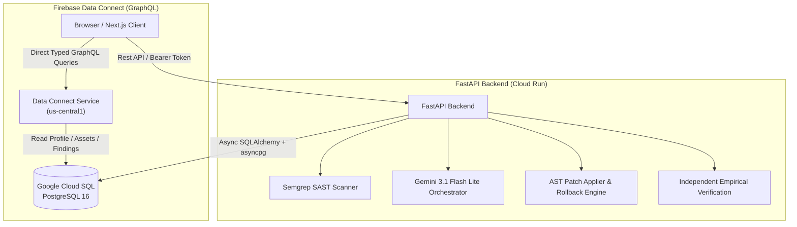

# ShadowOps — Firebase Data Connect (SQL Connect) Architecture Guide

**Document Version:** 1.0  
**Target Engine:** Firebase Data Connect (SQL Connect)  
**Underlying Data Source:** Google Cloud SQL for PostgreSQL 16 (`shadowops-prod-pg`)  
**Status:** Certified Architecture & Schemas Defined  

---

## 1. Firebase Data Connect Role & Architectural Boundary

Firebase Data Connect (also referred to as Firebase SQL Connect) provides a secure, type-safe GraphQL data layer natively bridged to Google Cloud SQL for PostgreSQL.

### 1.1 The Golden Boundary: Client Operations vs. Backend Engine
In ShadowOps, Firebase Data Connect is used strictly for **read-optimized client operations and lightweight telemetry mutations**. It is **not** used to replace the Python FastAPI backend or run security-sensitive workloads.



### 1.2 Separation Matrix
| Workload | Executed Via | Reason |
| :--- | :--- | :--- |
| **User Profile & Workspaces** | Firebase Data Connect | Fast, edge-cached lookup directly from client using Firebase Auth claims. |
| **Asset & Finding Lists** | Firebase Data Connect | Direct pagination and severity filtering without backend hop. |
| **Notification Mark Read** | Firebase Data Connect | Low-latency in-app user preference and status mutation. |
| **Semgrep SAST Scan Execution** | **FastAPI Backend Only** | Requires native OS binary, disk scratchpad (`/scan-workspace`), process lifecycle. |
| **AI Security Team Orchestration** | **FastAPI Backend Only** | Multi-agent recursive prompt loop, cost-capping, token management. |
| **Remediation Patching & Rollback** | **FastAPI Backend Only** | AST syntax validation, git diff application, SHA-256 checkpointing. |
| **Empirical Verification Engine** | **FastAPI Backend Only** | Baseline vs. post-patch diff execution and regression analysis. |
| **PDF & Compliance Reports** | **FastAPI Backend Only** | ReportLab binary compilation and signed document signing. |

---

## 2. PostgreSQL as the Single Source of Truth

- **No Schema Duplication:** The PostgreSQL database in Cloud SQL remains the sole authoritative schema owner.
- **Migration Ownership:** All table modifications, column additions, and constraint updates are applied via canonical SQL migrations ([`scripts/migration/02_cloud_sql_schema.sql`](file:///d:/Shreyanshcodes/shadow-ops-v2/scripts/migration/02_cloud_sql_schema.sql)).
- **Data Connect Schema Reflection:** The [`dataconnect/schema/schema.gql`](file:///d:/Shreyanshcodes/shadow-ops-v2/dataconnect/schema/schema.gql) file mirrors the underlying tables using `@table(name: "...")` and `@col(name: "...")` annotations.

---

## 3. Security & Authorization Model

### 3.1 Firebase Authentication Alone Is NOT Database Authorization
A valid Firebase ID token proves *who the user is* (`auth.uid`), but does **not** grant automatic access to any workspace. In a multi-tenant cybersecurity system, authorization must verify:
1. Is the caller authenticated? (`auth.uid != null`)
2. Is the caller an active member of the requested `workspace_id`?
3. Does the caller hold the required role (`owner`, `admin`, `member`, `viewer`)?

### 3.2 Implemented Data Connect Query Guardrails
Every operation defined in [`dataconnect/connector/queries.gql`](file:///d:/Shreyanshcodes/shadow-ops-v2/dataconnect/connector/queries.gql) applies strict `@auth` constraints:
```graphql
query GetCurrentProfile @auth(expr: "auth.uid != null") {
  profiles(where: { firebaseUid: { eq_expr: "auth.uid" } }) {
    id
    email
    role
  }
}
```
Queries targeting workspace assets or findings require the `$workspaceId` filter, preventing un-scoped global table scans.
