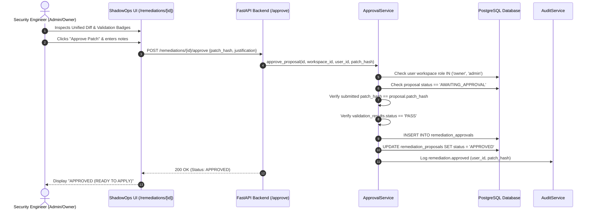

# HUMAN APPROVAL ARCHITECTURE — SHADOWOPS
## Stage 8 Human Sign-off & Policy Enforcement

**Date:** October 27, 2026  
**Status:** ACTIVE SPECIFICATION  

---

## 1. Principles of Human-in-the-Loop Governance

In ShadowOps, artificial intelligence agents are analytical and advisory. **AI never possesses autonomous authority to modify production code or infrastructure.**

### Mandatory Invariants:
1. **No Autonomous Patch Application**: No patch can be applied until an authenticated human operator explicitly signs off.
2. **Cryptographic Patch Hash Binding**: An approval is bound to the exact SHA-256 hash of the canonical unified diff reviewed by the human. If the patch is regenerated or modified, the approval is voided.
3. **Role Authorization Gate**: Only authorized roles (`owner`, `admin`) can approve or reject proposals. Read-only viewers cannot sign off.
4. **Validation Pre-Requisite**: Proposals that have failed automated validation (`VALIDATION_FAILED`) cannot be approved.
5. **Irreversible Rejection**: Once a proposal is rejected by a human operator, it is marked `REJECTED` and can never be applied.

---

## 2. Approval Verification Sequence

---

## 3. Approval Data Record (`remediation_approvals`)

Each sign-off is permanently recorded in the database:
- `id`: Unique approval UUID
- `proposal_id`: Target remediation proposal
- `workspace_id`: Multi-tenant workspace scope
- `approved_by`: Authenticated Firebase user profile UUID
- `decision`: `approved` or `rejected`
- `patch_hash`: 64-character hex SHA-256 hash of reviewed diff
- `proposal_version`: Integer version number at time of approval
- `justification`: Mandatory reason for rejection or optional notes for approval
- `validation_snapshot`: Exact JSON state of validation pipeline results at time of sign-off
- `approved_at`: ISO UTC timestamp
