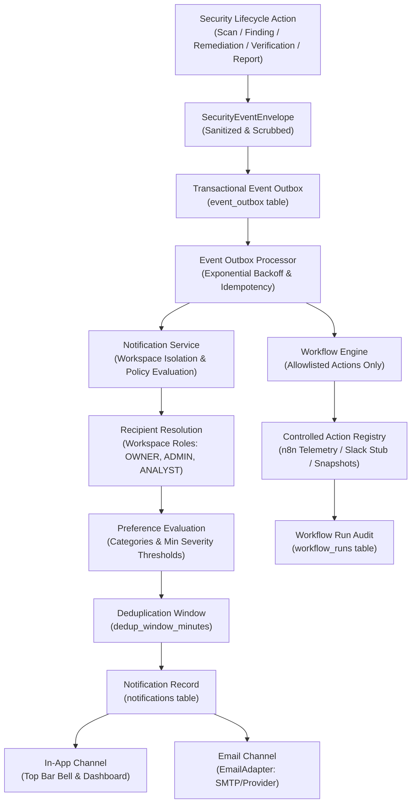

# Notification & Event Processing Architecture

## 1. Executive Summary

ShadowOps Stage 11 establishes an enterprise-grade, reliable, multi-tenant event processing and notification pipeline. Designed specifically for security automation in cybersecurity SaaS, the architecture enforces strict non-disruption guarantees: **a notification or webhook failure will never disrupt, rollback, or invalidate an authorized security scan, vulnerability remediation, fix verification, or executive reporting operation.**

---

## 2. End-to-End Pipeline

---

## 3. Core Architectural Principles

### 3.1 Non-Disruption Guarantee
All security operations complete their database transaction and business logic before or transactionally with the event envelope. If the notification pipeline experiences an external SMTP timeout, network outage, or webhook failure, the underlying security facts remain immutable and untainted.

### 3.2 Secret Redaction & Invariant Sanitization
Raw credentials, API keys, passwords, bearer tokens, and sensitive cryptographic material are strictly stripped from all event payloads before insertion into `event_outbox` or delivery to notifications via Pydantic validator sanitization.

### 3.3 Transactional Outbox Pattern
Rather than dispatching external HTTP or SMTP requests synchronously during an API request, events are published to `event_outbox`. A batch processor dispatches events, tracks attempts, applies exponential backoff with jitter on transient failures, and moves unrecoverable poison pills to `quarantined` state after `max_attempts`.

---

## 4. Multi-Tenant Recipient & Policy Engine

### 4.1 Role-Based Recipient Resolution
Notifications are automatically mapped to authorized workspace members according to event criticality:
- **Governance & Approval Events** (`remediation.approval_required`, `verification.human_review_required`): Automatically restricted to `OWNER` and `ADMIN` roles.
- **Operational & Informational Events** (`scan.completed`, `finding.created`, `report.ready`): Distributed to all subscribed members (`OWNER`, `ADMIN`, `ANALYST`, `MEMBER`).

### 4.2 User Notification Preferences
Users can independently customize their notification stream per workspace:
- **Category Subscriptions:** Toggles for `scans`, `findings`, `remediation`, `verification`, `reports`, and `risk`.
- **Delivery Channels:** Toggles for `in_app` and `email`.
- **Minimum Severity Threshold:** Suppresses noise below the selected threshold (`LOW`, `MEDIUM`, `HIGH`, `CRITICAL`).

### 4.3 Deduplication Windows
To prevent alert fatigue and notification storms during high-frequency scanner runs or repeated automated cycles, rules enforce a configurable deduplication window (`dedup_window_minutes`, default 10 min). Identical events for the same resource within the window are suppressed.
