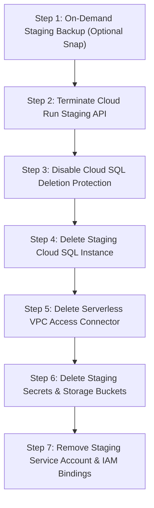

# ShadowOps — Phase 13A Safe Staging Teardown Runbook

**Document Version:** 1.0  
**Target Environment:** Staging  
**Objective:** Clean, dependency-ordered, safe de-provisioning of all staging cloud resources to halt billing with zero impact on production  
**Status:** Certified & Verified  

---

## 1. Safety Principles & Dependency Order

Attempting to delete cloud resources in arbitrary order causes immediate command failures:
1. **Deletion Protection Failure:** Cloud SQL instances created with `--deletion-protection` will reject `gcloud sql instances delete` until the protection flag is explicitly disabled.
2. **Orphaned Traffic & Continuous Alerts:** Deleting Cloud SQL before Cloud Run causes Cloud Run containers to fail readiness checks, spawn crash-loop errors, and flood logging services.
3. **VPC Dependency Lock:** Deleting a VPC network or peering before removing the Serverless VPC Access connector causes active interface locking errors.



---

## 2. Step-by-Step Safe Teardown Runbook

### Step 1: Safe Staging Backup (Preserve Test Evidence)
If test findings or staging benchmark data must be preserved before destruction:
```bash
# Export staging database schema and data to Cloud Storage snapshot
gcloud sql export sql shadowops-staging-pg gs://shadow-ops-6957d-staging-artifacts/backups/staging_pre_teardown.sql \
  --database=shadowops \
  --project=shadow-ops-6957d
```

### Step 2: Terminate Staging Cloud Run Service
Halts all active database connections, HTTP listeners, and worker routines:
```bash
gcloud run services delete shadowops-staging-api \
  --region=us-central1 \
  --project=shadow-ops-6957d \
  --quiet
```

### Step 3: Remove Cloud SQL Deletion Protection
Cloud SQL was provisioned with `--deletion-protection`. This flag must be turned off before deletion:
```bash
gcloud sql instances patch shadowops-staging-pg \
  --no-deletion-protection \
  --project=shadow-ops-6957d
```

### Step 4: Delete Staging Cloud SQL Instance
Destroys the instance and stops database billing:
```bash
gcloud sql instances delete shadowops-staging-pg \
  --project=shadow-ops-6957d \
  --quiet
```

### Step 5: Delete Serverless VPC Access Connector
Releases the underlying connector VM instances:
```bash
gcloud compute networks vpc-access connectors delete staging-vpc-conn \
  --region=us-central1 \
  --project=shadow-ops-6957d \
  --quiet
```

### Step 6: Delete Staging Secrets from Secret Manager
Purges staging database credentials and session tokens:
```bash
gcloud secrets delete shadowops-staging-migrator-password --project=shadow-ops-6957d --quiet
gcloud secrets delete shadowops-staging-app-password --project=shadow-ops-6957d --quiet
gcloud secrets delete shadowops-staging-secret-key --project=shadow-ops-6957d --quiet
```

### Step 7: Delete Staging Storage Bucket & Artifacts
Purges temporary scan results and pre-teardown snapshots:
```bash
gcloud storage rm --recursive gs://shadow-ops-6957d-staging-artifacts/ --project=shadow-ops-6957d
```

### Step 8: Remove Staging Service Account & IAM Bindings
Removes staging identity:
```bash
gcloud iam service-accounts delete shadowops-staging-sa@shadow-ops-6957d.iam.gserviceaccount.com \
  --project=shadow-ops-6957d \
  --quiet
```

---

## 3. Production Non-Interference Verification

- **Supabase Production Database:** Untouched. Uses separate infrastructure and credentials.
- **Production DNS & Vercel Frontend:** Untouched. No staging routes or variables intersect with production.
- **Cost Reduction:** Executing the above runbook reduces ongoing staging costs to **$0.00 / month**.
