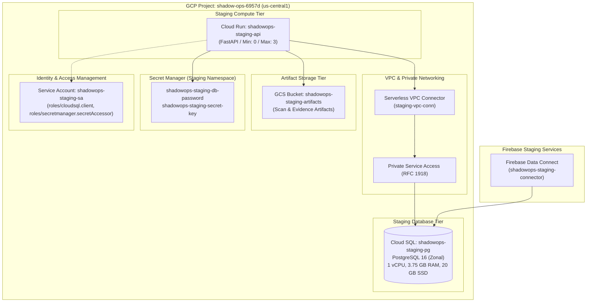

# ShadowOps — Phase 13 Staging Architecture & Cost Specification

**Document Version:** 1.0  
**Environment:** Staging (Isolated Pre-Production Sandbox)  
**Target GCP Project:** `shadow-ops-6957d`  
**Primary Region:** `us-central1` (Iowa, USA)  
**Status:** Architecture Certified — Awaiting Provisioning Approval  

---

## 1. Staging Topology & Isolation Boundary

The staging environment is completely decoupled from the production Supabase database, existing client endpoints, and external services.

---

## 2. Resource Specifications & Naming Conventions

To guarantee zero collision with production resources, all staging entities use explicit `-staging` naming:

| Component | Staging Resource Name | Production Counterpart | Purpose |
| :--- | :--- | :--- | :--- |
| **Cloud SQL Instance** | `shadowops-staging-pg` | `shadowops-prod-pg` | PostgreSQL 16 database |
| **Cloud Run Service** | `shadowops-staging-api` | `shadowops-backend` | Staging FastAPI REST API |
| **Cloud Storage** | `shadow-ops-6957d-staging-artifacts` | `shadowops-artifacts` | Scan & evidence storage |
| **Data Connect Connector** | `shadowops-staging-connector` | `shadowops-connector` | Staging GraphQL data layer |
| **VPC Connector** | `staging-vpc-conn` | `prod-vpc-conn` | Cloud Run to Cloud SQL private networking |
| **Service Account** | `shadowops-staging-sa` | `shadowops-backend-sa` | Least-privilege IAM service account |

---

## 3. Right-Sized Staging vs. Production Sizing

Staging is cost-optimized for testing and automated verification without sacrificing PostgreSQL 16 operational compatibility:

| Parameter | Staging Configuration | Production Target | Rationale for Staging |
| :--- | :--- | :--- | :--- |
| **Cloud SQL Tier** | `db-custom-1-3840` (1 vCPU, 3.75 GB) | `db-custom-4-15360` (4 vCPU, 15 GB) | Avoids micro-tier CPU throttling during schema indexing. |
| **High Availability** | Zonal (`us-central1-a`) | Regional HA (Multi-zone failover) | Eliminates 100% idle standby replica cost in staging. |
| **Storage** | 20 GB SSD (Auto-increase) | 100 GB SSD | Minimizes fixed disk footprint. |
| **Backups** | Automated daily, 7-day retention | Automated daily, 30-day retention | Sufficient for staging recovery validation. |
| **Point-in-Time (PITR)**| Enabled (WAL archiving) | Enabled | Allows validating point-in-time recovery workflows. |
| **Deletion Protection** | Enabled | Enabled | Prevents accidental deletion of the staging instance. |
| **Cloud Run Scaling** | Min: 0 / Max: 3 | Min: 1 / Max: 10 | Scales to zero when no test suites are running ($0 compute). |

---

## 4. Estimated Infrastructure Costs (Staging)

| Cloud Resource | Staging Unit Sizing | Billing Metric | Estimated Monthly Cost |
| :--- | :--- | :--- | :--- |
| **Cloud SQL (`shadowops-staging-pg`)** | 1 vCPU, 3.75 GB RAM, 20 GB SSD | ~$0.08 / hour | **~$55.00 / month** |
| **Serverless VPC Access (`staging-vpc-conn`)** | 2 `f1-micro` / `e2-micro` instances | ~$0.01 / hour | **~$7.50 / month** |
| **Cloud Run (`shadowops-staging-api`)** | Min 0 (Scales to 0) | Request / CPU-sec | **~$0.00 – $3.00 / month** |
| **Cloud Storage (`shadowops-staging-artifacts`)** | Standard Storage (< 5 GB) | $0.02 / GB | **<$0.50 / month** |
| **Secret Manager** | 2 active secrets, < 10k API calls | $0.06 / secret | **<$0.20 / month** |
| **Firebase Data Connect** | Development / Staging usage | Free tier quota | **$0.00** |
| **TOTAL ESTIMATED STAGING COST** | | | **~$62.00 – $66.00 / month** (~$2.10 / day) |

> [!TIP]  
> Because Cloud SQL is billed per second, the staging instance can be stopped or destroyed after verification testing to incur only fractional daily costs (e.g., ~$4.00 for 48 hours of testing).

---

## 5. Least-Privilege Database Users

The staging database enforces strict privilege segregation:

1. **`shadowops_migrator` (DDL Owner):**
   - Owns the `public` schema in database `shadowops`.
   - Used only during schema deployment and migrations.
2. **`shadowops_app` (DML Application User):**
   - Granted strictly `SELECT`, `INSERT`, `UPDATE`, `DELETE` on all application tables.
   - Granted `USAGE, SELECT` on sequences.
   - **Zero DDL privileges:** Cannot `DROP`, `ALTER`, or `CREATE` tables.
