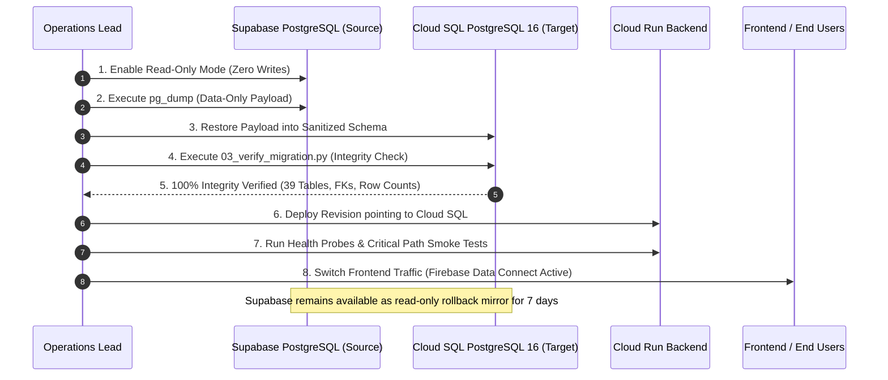

# ShadowOps — Production Database Cutover & Rollback Plan

**Document Version:** 1.0  
**Target Cutover:** Supabase PostgreSQL → Google Cloud SQL for PostgreSQL 16  
**Execution Type:** Zero-Data-Loss Controlled Maintenance Window  
**Authorization Required:** Explicit Engineering Signoff Prior to Traffic Shift  

---

## 1. Migration Runbook Timeline



---

## 2. Phase-by-Phase Execution Runbook

### Step 1: Pre-Cutover Readiness Check
- [ ] Verify Google Cloud project `shadow-ops-6957d` has Cloud SQL instance `shadowops-prod-pg` running in `us-central1`.
- [ ] Confirm automated backups and point-in-time recovery (PITR) are enabled on Cloud SQL.
- [ ] Confirm Secret Manager secrets (`shadowops-database-url`, `shadowops-db-password`) are configured.
- [ ] Confirm Cloud Run service account `shadowops-backend-sa` holds `roles/cloudsql.client`.
- [ ] Validate canonical DDL applied: [`scripts/migration/02_cloud_sql_schema.sql`](file:///d:/Shreyanshcodes/shadow-ops-v2/scripts/migration/02_cloud_sql_schema.sql).

### Step 2: Maintenance Window Initiation & Source Freeze
1. Set maintenance banner on Next.js frontend if desired.
2. Put Supabase PostgreSQL in read-only mode to prevent write drift:
   ```sql
   ALTER DATABASE postgres SET default_transaction_read_only = true;
   ```

### Step 3: Source Data Export
Execute the automated export script:
```bash
export SOURCE_SUPABASE_DB_URL="postgresql://postgres:[PASSWORD]@[HOST]:5432/postgres"
export TARGET_CLOUDSQL_DB_URL="postgresql://shadowops_migrator:[PASSWORD]@[PRIVATE_IP]:5432/shadowops"

bash ./scripts/migration/01_export_supabase_data.sh
```

### Step 4: Data Import into Cloud SQL
1. Set session replication role to replica to defer constraints during bulk import:
   ```sql
   SET session_replication_role = 'replica';
   \i ./backups/supabase_data_only.sql
   SET session_replication_role = 'origin';
   ```
2. Re-synchronize sequences:
   ```sql
   SELECT setval('audit_logs_id_seq', COALESCE((SELECT MAX(id)+1 FROM audit_logs), 1), false);
   ```

### Step 5: Migration Integrity Verification
Run the automated verification suite:
```bash
python3 ./scripts/migration/03_verify_migration.py --db-url "$TARGET_CLOUDSQL_DB_URL"
```
Verification passes only when:
- All 39 tables report 0 missing tables.
- Row counts match source database row counts.
- Foreign-key integrity has 0 orphaned child rows.
- Roles reference table contains `owner`, `admin`, `member`, `viewer`.

### Step 6: Backend Traffic Cutover (Cloud Run)
Deploy new Cloud Run revision routing to Cloud SQL:
```bash
gcloud run services update shadowops-backend \
  --set-env-vars="USE_CLOUD_SQL_CONNECTOR=True,CLOUD_SQL_CONNECTION_NAME=shadow-ops-6957d:us-central1:shadowops-prod-pg,CLOUD_SQL_DATABASE=shadowops,CLOUD_SQL_USER=shadowops_app" \
  --set-secrets="CLOUD_SQL_PASSWORD=shadowops-db-password:latest" \
  --region=us-central1 \
  --project=shadow-ops-6957d
```

### Step 7: Post-Cutover Smoke Tests
- [ ] Authenticate with Firebase Auth and verify profile loading.
- [ ] Navigate to Workspace dashboard; confirm findings count and risk scores render.
- [ ] Run a test Semgrep scan on a sample repository.
- [ ] Test AI Security Chat consultation.
- [ ] Create a proposal approval and verify audit log generation.

---

## 3. Rollback Trigger Conditions & Procedure

### Rollback Triggers:
1. `03_verify_migration.py` detects missing tables, broken foreign keys, or row count mismatch > 0.
2. Cloud Run error rate exceeds 1% during initial smoke testing.
3. Database latency p95 exceeds 500ms on basic workspace queries.

### Rollback Steps (Estimated Duration: < 5 minutes):
1. **Revert Cloud Run traffic:** Route traffic back to the prior Cloud Run revision (or update `DATABASE_URL` pointing back to Supabase):
   ```bash
   gcloud run services update-traffic shadowops-backend \
     --to-revisions=PREVIOUS_REVISION=100 \
     --region=us-central1 \
     --project=shadow-ops-6957d
   ```
2. **Re-enable Writes on Supabase:**
   ```sql
   ALTER DATABASE postgres SET default_transaction_read_only = false;
   ```
3. **Notify Engineering Team:** Log incident and preserve Cloud SQL logs for forensic analysis.
