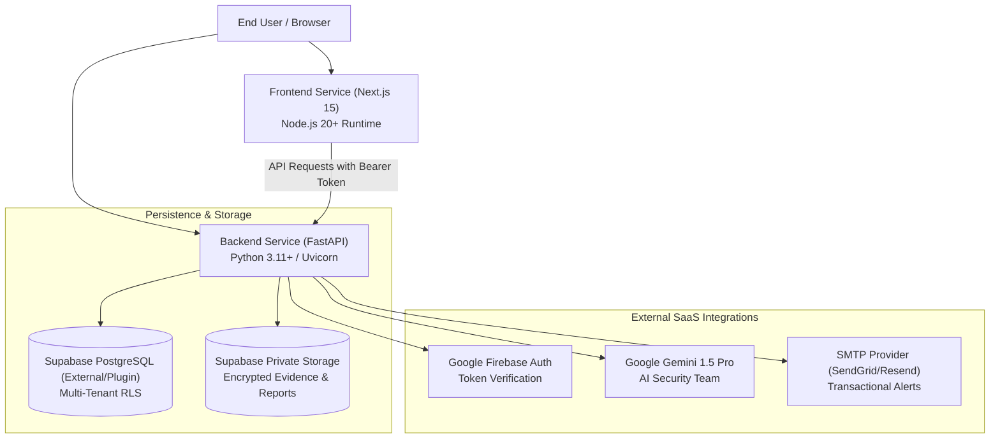

# ShadowOps Production Railway Deployment Guide

**Document Version:** 2.0 (Stage 12 Release)  
**Deployment Target:** Railway PaaS  
**Status:** Certified for Controlled Pilot Deployment  

---

## 1. Architecture Topology on Railway

ShadowOps deploys to Railway as a multi-service architecture with a separated frontend edge, API application server, database persistence, and external security services:



---

## 2. Service Definitions

### Service A: Backend API (`shadowops-backend`)
- **Source Directory:** `backend` or Dockerfile at root
- **Runtime:** Python 3.11+ (or Docker container with Semgrep CLI)
- **Start Command:**
  ```bash
  uvicorn app.main:app --host 0.0.0.0 --port $PORT --workers 2 --proxy-headers --forwarded-allow-ips='*'
  ```
- **Healthcheck Path:** `/api/v1/health/live`
- **Readiness Path:** `/api/v1/health/ready`
- **Resource Sizing:**
  - Pilot: 1 vCPU, 1 GB RAM
  - Production (GA): 2 vCPU, 2 GB RAM (autoscaling 2-4 instances)

### Service B: Frontend (`shadowops-frontend`)
- **Source Directory:** `frontend`
- **Build Command:** `npm run build`
- **Start Command:** `npm run start -- -p $PORT`
- **Healthcheck Path:** `/login`
- **Resource Sizing:**
  - Pilot: 1 vCPU, 512 MB RAM
  - Production (GA): 1 vCPU, 1 GB RAM

---

## 3. Environment Variables Reference

### Backend Service Environment Variables:

| Variable | Required? | Recommended Production Value | Description |
| :--- | :---: | :--- | :--- |
| `ENVIRONMENT` | Yes | `production` | Enables production security mode and disables fallback token decoding |
| `DATABASE_URL` | Yes | `postgresql+asyncpg://postgres:[PWD]@[HOST]:5432/postgres` | Supabase PostgreSQL async connection string |
| `FIREBASE_PROJECT_ID` | Yes | `shadowops-prod` | Firebase project identifier |
| `FIREBASE_SERVICE_ACCOUNT_KEY` | Yes | `{"type": "service_account", ...}` | JSON credentials string for Firebase Admin SDK |
| `CORS_ORIGINS` | Yes | `["https://app.shadowops.io"]` | Allowed frontend origin domains |
| `SEMGREP_PATH` | No | `semgrep` | Path to Semgrep CLI binary in container PATH |
| `GEMINI_API_KEY` | Optional | `AIzaSy...` | API key for Gemini 1.5 Pro security team orchestration |
| `GROK_API_KEY` | Optional | `xai-...` | Optional Grok API key |
| `SMTP_HOST` | Optional | `smtp.sendgrid.net` | Outgoing email server |
| `SMTP_PORT` | Optional | `587` | Outgoing email port |
| `SMTP_USER` | Optional | `apikey` | SMTP authentication username |
| `SMTP_PASSWORD` | Optional | `SG.xxxxx` | SMTP API key / secret |
| `SMTP_FROM_EMAIL` | Optional | `security-alerts@shadowops.io` | Verified sender address |
| `N8N_ENABLED` | No | `false` | External n8n automation disabled by default |

### Frontend Service Environment Variables:

| Variable | Required? | Recommended Production Value | Description |
| :--- | :---: | :--- | :--- |
| `NEXT_PUBLIC_API_URL` | Yes | `https://api.shadowops.io/api/v1` | Public URL of the FastAPI backend service |
| `NEXT_PUBLIC_FIREBASE_API_KEY` | Yes | `AIzaSy...` | Firebase Web API key |
| `NEXT_PUBLIC_FIREBASE_AUTH_DOMAIN` | Yes | `shadowops-prod.firebaseapp.com` | Firebase Auth domain |
| `NEXT_PUBLIC_FIREBASE_PROJECT_ID` | Yes | `shadowops-prod` | Firebase project ID |
| `NEXT_PUBLIC_FIREBASE_STORAGE_BUCKET`| Yes | `shadowops-prod.appspot.com` | Firebase storage bucket |
| `NEXT_PUBLIC_FIREBASE_MESSAGING_SENDER_ID`| Yes | `1234567890` | Firebase sender ID |
| `NEXT_PUBLIC_FIREBASE_APP_ID` | Yes | `1:1234567890:web:abcdef` | Firebase app ID |

---

## 4. Database Migration Execution on Railway

Never run migrations inside application startup hooks in production. Run migrations either via a one-off Railway CLI command or through a dedicated release pipeline:

```bash
# Using Supabase CLI to apply migrations
supabase db push --db-url "postgresql://postgres:[PASSWORD]@[HOST]:5432/postgres"

# Or using the automated migration auditor script:
python backend/tests/test_stage12_migrations_audit.py
```

All 10 migrations in `supabase/migrations/` are idempotent, sequentially numbered, and enforce transactional safety:
- `001_initial_schema.sql`
- `002_scans_and_semgrep.sql`
- `003_findings_and_evidence.sql`
- `004_ai_security_analyst.sql`
- `005_attack_paths_and_risk.sql`
- `006_ai_security_team.sql`
- `007_remediation_and_approvals.sql`
- `008_verification_engine.sql`
- `009_reports_and_dashboards.sql`
- `0011_stage11_notifications.sql`

---

## 5. Zero-Downtime Healthcheck Configuration

Configure Railway healthcheck probes to prevent routing traffic to unready containers:
- **Liveness Probe (`/api/v1/health/live`):**
  - Timeout: 5s
  - Interval: 10s
  - Success Threshold: 1
  - Failure Threshold: 3
  - Action on Failure: Container restart
- **Readiness Probe (`/api/v1/health/ready`):**
  - Evaluates database connectivity, Semgrep executable availability, and event outbox backlog.
  - Returns `200 OK` when ready; returns `503 Service Unavailable` during startup or DB disruption.
  - Action on Failure: Temporarily remove container from load balancer routing.

---

## 6. Rollback Procedures

If a deployment fails or introduces regressions:
1. **Frontend Rollback:** Use Railway's deployment history to click "Rollback" to the previous immutable deployment commit.
2. **Backend Rollback:** Click "Rollback" on the backend service. Because database migrations are backward-compatible and additive, rolling back backend code does not require immediate schema reversal.
3. **Database Rollback:** If a migration must be reverted, consult [BACKUP_AND_RECOVERY.md](file:///d:/Shreyanshcodes/shadow-ops-v2/docs/BACKUP_AND_RECOVERY.md) and execute the corresponding down-migration script.
