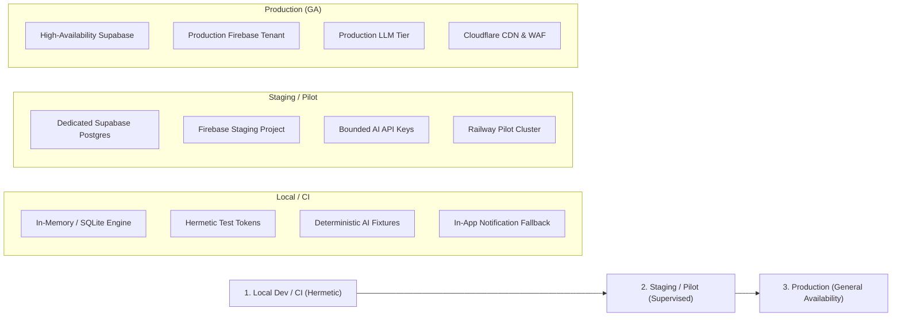

# ShadowOps Testing Strategy & Environment Architecture

**Document Version:** 1.0  
**Phase:** Stage 12 Production Hardening  
**Target Audience:** DevOps, QA, and Software Engineers  

---

## 1. Overview & Testing Philosophy

ShadowOps follows a strict **hermetic-first** testing methodology. The primary test suite executes without external network dependencies, ensuring that builds are fast, deterministic, reproducible, and immune to third-party outages.

### Core Testing Invariants:
1. **Zero External Flakiness:** Tests must not fail due to network hiccups, rate limits on third-party APIs (Google Firebase, Supabase, Gemini, Grok, SMTP), or credential expirations.
2. **Explicit Environment Separation:** Hermetic tests run against in-memory/isolated SQLite engines or ephemeral test databases; live integrations require explicit configuration flags.
3. **Multi-Tenant Regression Prevention:** Every resource access test must explicitly assert that foreign tenants are denied access (`403 Forbidden` or `404 Not Found`).

---

## 2. Environment Tiers



### Environment Matrix:

| Feature / Service | Local CI / Hermetic | Staging / Pilot | Production (GA) |
| :--- | :--- | :--- | :--- |
| **Database** | SQLite via `aiosqlite` | Supabase PostgreSQL | Supabase PostgreSQL + PITR |
| **Authentication** | `test-token-<uid>` claims | Firebase Staging Tenant | Firebase Production Tenant |
| **Scanner Engine** | Semgrep CLI / Mock | Semgrep CLI in Docker | Semgrep CLI in Isolated Worker |
| **AI Analysis** | Hermetic structured mocks | Gemini / Grok Staging Keys | Gemini / Grok Production Tier |
| **Email Delivery** | Fallback `not_configured` | SendGrid / Postmark Sandbox | SendGrid / Resend Production |
| **Automation** | Disabled (`N8N_ENABLED=false`) | Optional Sandboxed Webhook | Isolated n8n Microservice |
| **Hosting** | Local Uvicorn + Next.js | Railway Staging | Railway Multi-Region Cluster |

---

## 3. Pytest Configuration & Test Categories

The test framework is configured in the root [pytest.ini](file:///d:/Shreyanshcodes/shadow-ops-v2/pytest.ini):

```ini
[pytest]
pythonpath = backend
testpaths = backend/tests
asyncio_mode = strict
markers =
    unit: Fast hermetic unit tests with zero I/O
    integration: Integration tests exercising DB models and service adapters
    e2e: Simulated end-to-end multi-step workflow acceptance tests
    live_service: Tests requiring live external cloud credentials (disabled by default)
```

### Test Suite Structure:
- `backend/tests/test_stage12_e2e_acceptance.py`: Canonical 18-step simulated happy path and 3 negative security invariants.
- `backend/tests/test_stage12_migrations_audit.py`: Validates all 10 SQL migration files for sequential consistency, FK indexing, and RLS statements.
- `backend/tests/test_stage11_notifications.py`: Outbox, email adapter, event deduplication, and workflow security.
- `backend/tests/test_stage10_reports.py`: Executive dashboard metrics, PDF/JSON generation, secret redaction.
- `backend/tests/test_stage9_verification.py`: Fix verification policy engine, regression checks, and human sign-off RBAC.
- `backend/tests/test_stage8_remediation.py`: Patch proposal generation, hash binding, and rollback checkpoints.
- `backend/tests/test_stage7_security_team.py`: Multi-agent team coordination, consensus engine.
- `backend/tests/test_stage6_*.py`: Deterministic risk engine, attack path graph construction.
- `backend/tests/test_stage5_ai_analyst.py`: AI security analyst, prompt injection defenses, fact preservation.
- `backend/tests/test_scans_lifecycle.py` & `test_scanner_security_invariant.py`: Scanner execution and authorization boundaries.
- `backend/tests/test_auth.py`, `test_workspaces.py`, `test_assets.py`: Foundation tenancy and asset lifecycle.

---

## 4. How to Execute Tests

### 4.1 Run Full Hermetic Test Suite
```bash
# From workspace root
backend\venv\Scripts\python.exe -m pytest backend/tests/ -v
```

### 4.2 Run Specific Stage Tests
```bash
# Stage 12 acceptance & negative tests
backend\venv\Scripts\python.exe -m pytest backend/tests/test_stage12_e2e_acceptance.py -v

# Stage 12 migration integrity audit
backend\venv\Scripts\python.exe -m pytest backend/tests/test_stage12_migrations_audit.py -v
```

### 4.3 Run Frontend Validations
```bash
# TypeScript type check
npm --prefix frontend run typecheck

# ESLint code style
npm --prefix frontend run lint

# Production Next.js build
npm --prefix frontend run build
```

---

## 5. Live Service Integration Testing (Pre-GA Checklist)

Before promoting from **Controlled Pilot** to **General Availability (GA)**, run the live service validation suite using live cloud credentials:

1. **Live Firebase Validation:** Set `FIREBASE_PROJECT_ID` and `FIREBASE_SERVICE_ACCOUNT_KEY`; verify real Google token verification with signature checking.
2. **Live Supabase PostgreSQL RLS Validation:** Connect to a live Supabase instance; execute migrations and verify that PostgreSQL rejects cross-tenant queries at the database tier.
3. **Live AI Latency & Rate Limits:** Set `GEMINI_API_KEY` and verify structured JSON extraction under peak concurrency.
4. **Live Email Notification:** Configure SMTP settings; verify DKIM/SPF passing on delivered alerts.
